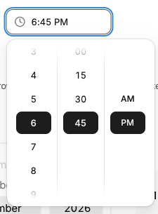

# Time picker

Use a time picker for a clock time in a form. The gallery has a 24-hour field and a 12-hour field with quarter-hour choices. Available in **GUI**.




## Example

```pascal
unit Docs.Ui.Pickers.TimePicker;

uses Fpas.Ui.Elements as E;
uses Fpas.Ui.Widgets.Pickers.TimePickers as W;
uses System as Sys;

// Builds the time picker example.
// ## Parameters
// - `Time`: Current value from the application model.
// ## Returns
// The widget for the application view.
public function View(Time: Sys.TimeOnly): E.Element<Sys.TimeOnly>;
begin
  return W.TimePicker<Sys.TimeOnly>('picker-end-time', Time, function(Value: Sys.TimeOnly): Sys.TimeOnly => Value,
    new W.Options(TwelveHour := true, MinuteStep := 15));
end function;

end unit;
```

## Options and defaults

| Option | Default or requirement |
| --- | --- |
| `Value` | System.TimeOnly at minute precision. |
| `Label / Width` | Empty / 0, which uses CUI's default width. |
| `TwelveHour` | false. Enable it to show the AM/PM column. |
| `MinuteStep` | 5. Accepts 1 through 60. |
| `Enabled` | true. |

## Interaction

Click the field or press Enter while it has focus. Choose an hour, a minute or an AM/PM period to propose a time. CUI scrolls the columns to make other choices available. Escape closes the popup and restores focus to the field.

## See also

- [Widget API and types](../../../../src/Fpas.Ui/Widgets/Pickers/TimePickers.fpas)
- [Gallery example](../../../../examples/ui/gui/gallery/Pages/Pickers/Widgets/Time.fpas)
- [Time dial](time-dial.md)
- [Pickers](README.md)

## Source files

- `src/Fpas.Ui.Gui/Internal/Widgets/Pickers/`
  - [TimePicker.fpas](../../../../src/Fpas.Ui.Gui/Internal/Widgets/Pickers/TimePicker.fpas)
- `src/Fpas.Ui.Gui.Cui/Interop/Pickers/`
  - [NativeMethods.TimePicker.cs](../../../../src/Fpas.Ui.Gui.Cui/Interop/Pickers/NativeMethods.TimePicker.cs)
- `src/Fpas.Ui.Gui.Cui/Widgets/Pickers/`
  - [CuiWindow.TimePicker.Types.cs](../../../../src/Fpas.Ui.Gui.Cui/Widgets/Pickers/CuiWindow.TimePicker.Types.cs)
  - [CuiWindow.TimePicker.cs](../../../../src/Fpas.Ui.Gui.Cui/Widgets/Pickers/CuiWindow.TimePicker.cs)
- `src/Fpas.Ui.Gui.Cui/native/widgets/pickers/`
  - [time_picker.c](../../../../src/Fpas.Ui.Gui.Cui/native/widgets/pickers/time_picker.c)
  - [time_picker.h](../../../../src/Fpas.Ui.Gui.Cui/native/widgets/pickers/time_picker.h)
- `tests/Fixtures/gui-host/`
  - [TimePickersContract.fpas](../../../../tests/Fixtures/gui-host/TimePickersContract.fpas)
