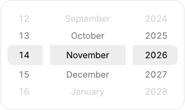

# Wheel picker

Use a wheel to pick one caption at the center of a scrolling list. The gallery joins separate wheels for day, month and year. Available in **GUI**.



## Example

```pascal
unit Docs.Ui.Pickers.WheelPicker;

uses Fpas.Ui.Elements as E;
uses Fpas.Ui.Widgets.Pickers.WheelPickers as W;

// Builds the wheel picker example.
// ## Parameters
// - `Selected`: Current value from the application model.
// ## Returns
// The widget for the application view.
public function View(Selected: int): E.Element of int;
begin
  return W.WheelPicker of int('picker-wheel-month', ['January', 'February', 'March', 'April', 'May',
    'June', 'July', 'August', 'September', 'October', 'November', 'December'],
    Selected, function(Index: int): int => Index,
    new W.Options(Width := 128.0F, Loop := true));
end function;

end unit;
```

## Options and defaults

| Option | Default or requirement |
| --- | --- |
| `Items / Selected` | Nonempty captions and a zero-based model index. |
| `Width` | 0 selects CUI's default width. |
| `Rows` | 5. CUI rounds even counts up to an odd count. |
| `Loop / JoinLeft / JoinRight` | false / false / false. Join flags connect the selection band to a neighboring wheel. |
| `Enabled` | true. |

## Interaction

Drag the list, use the mouse wheel or move with the arrow keys. The callback receives the proposed index. When Loop is enabled, passing an end continues at the other end. If several wheels form one date, resolve combinations such as February 31 in the application.

## See also

- [Widget API and types](../../../../src/Fpas.Ui/Widgets/Pickers/WheelPickers.fpas)
- [Gallery example](../../../../examples/ui/gui/gallery/Pages/Pickers/Widgets/WheelsAndDial.fpas)
- [Pickers](README.md)

## Source files

- `src/Fpas.Ui.Gui/Internal/Widgets/Pickers/`
  - [WheelPicker.fpas](../../../../src/Fpas.Ui.Gui/Internal/Widgets/Pickers/WheelPicker.fpas)
- `src/Fpas.Ui.Gui.Cui/Interop/Pickers/`
  - [NativeMethods.WheelPicker.cs](../../../../src/Fpas.Ui.Gui.Cui/Interop/Pickers/NativeMethods.WheelPicker.cs)
- `src/Fpas.Ui.Gui.Cui/Widgets/Pickers/`
  - [CuiWindow.WheelPicker.cs](../../../../src/Fpas.Ui.Gui.Cui/Widgets/Pickers/CuiWindow.WheelPicker.cs)
- `src/Fpas.Ui.Gui.Cui/native/tests/`
  - [wheel_interruption.c](../../../../src/Fpas.Ui.Gui.Cui/native/tests/wheel_interruption.c)
- `src/Fpas.Ui.Gui.Cui/native/widgets/pickers/`
  - [wheel_picker.c](../../../../src/Fpas.Ui.Gui.Cui/native/widgets/pickers/wheel_picker.c)
  - [wheel_picker.h](../../../../src/Fpas.Ui.Gui.Cui/native/widgets/pickers/wheel_picker.h)
