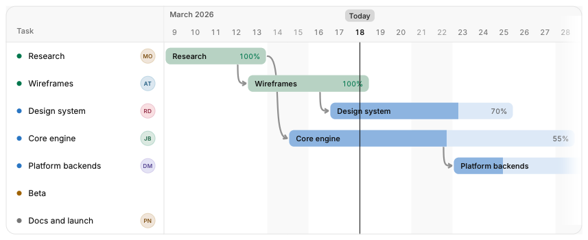

# Gantt chart

Use a Gantt chart to schedule tasks and show dependencies. The gallery
plots research through launch, with a diamond for the Beta milestone.
Available in **GUI**.



## Example

```pascal
unit Docs.Ui.Planning.Gantt;

uses Fpas.Ui.Elements as E, Fpas.Ui.Widgets.Planning.Gantts as W, System as Sys;

// Shows a project schedule.
// ## Parameters
// - `Origin`: First date of the timeline.
// - `Tasks`: Current model-owned tasks.
// ## Returns
// The Gantt chart with schedule proposals.
public function View(Origin: Sys.DateOnly; Tasks: array of W.Task): E.Element<W.Event>;
begin
  return W.Gantt<W.Event>('release', new W.Value(Origin, 42, Tasks),
    function(Change: W.Event): W.Event => Change, new W.Options(Today := 9));
end function;

// Creates a task and its completion milestone.
// ## Returns
// Two example tasks, with the second depending on the first.
public function ExampleTasks(): array of W.Task;
begin
  return [new W.Task('Prototype', 0, 6, 0.5F),
    new W.Task('Demo', 7, 7, DependsOn := 0, Milestone := true)];
end function;

end unit;
```

## Options and defaults

| Option | Default or requirement |
| --- | --- |
| `Value.Origin / Days` | Supply the first date and the timeline length in days. |
| `Task.Start / Finish / DependsOn` | Dates are offsets from Origin. DependsOn defaults to minus one. Set it to the dependency's task index. |
| `Task.Progress / Milestone / State` | 0 / false / Automatic. A milestone draws a diamond. |
| `Today / DayWidth / RowHeight` | All zero. Zero Today hides the marker. Other zeros use native dimensions. |
| `ReadOnly / Enabled` | false / true. ReadOnly keeps activation and disables edits. |

For task bars, `Start` is inclusive and `Finish` is exclusive: offsets 0 and 1
make a one-day task. A milestone may use equal start and finish offsets.

## Interaction

Drag the bar to move a task, or pull either end to resize it. Dependency
curves follow the dates passed to the chart. Store `Event.Tasks` to accept
a schedule proposal. A nonnegative `Activated` indexes the task to open.
Scroll the timeline horizontally to see later dates.

## See also

- [Widget API and types](../../../../src/Fpas.Ui/Widgets/Planning/Gantts.fpas)
- [Gallery example](../../../../examples/ui/gui/gallery/Pages/Planning/View.fpas)
- [Planning](README.md)

## Source files

- `src/Fpas.Ui.Gui/Internal/Widgets/Planning/`
  - [Gantt.fpas](../../../../src/Fpas.Ui.Gui/Internal/Widgets/Planning/Gantt.fpas)
- `src/Fpas.Ui.Gui.Cui/Interop/Planning/`
  - [NativeMethods.Gantt.Types.cs](../../../../src/Fpas.Ui.Gui.Cui/Interop/Planning/NativeMethods.Gantt.Types.cs)
  - [NativeMethods.Gantt.cs](../../../../src/Fpas.Ui.Gui.Cui/Interop/Planning/NativeMethods.Gantt.cs)
- `src/Fpas.Ui.Gui.Cui/Widgets/Planning/`
  - [CuiWindow.Gantt.Types.cs](../../../../src/Fpas.Ui.Gui.Cui/Widgets/Planning/CuiWindow.Gantt.Types.cs)
  - [CuiWindow.Gantt.cs](../../../../src/Fpas.Ui.Gui.Cui/Widgets/Planning/CuiWindow.Gantt.cs)
- `src/Fpas.Ui.Gui.Cui/native/widgets/planning/`
  - [gantt.c](../../../../src/Fpas.Ui.Gui.Cui/native/widgets/planning/gantt.c)
  - [gantt.h](../../../../src/Fpas.Ui.Gui.Cui/native/widgets/planning/gantt.h)
