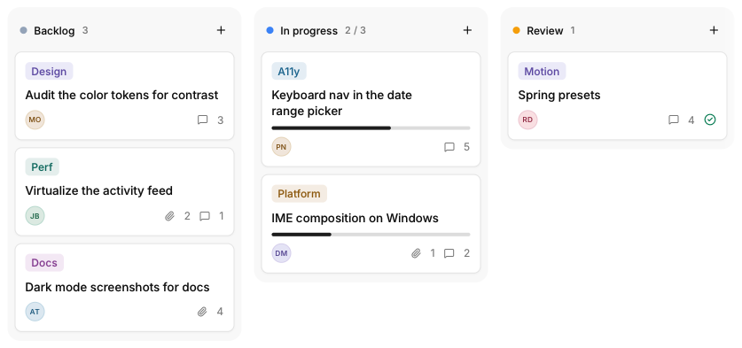

# Kanban

Use Kanban to group cards by status and let users reorder them. The gallery
composes card bodies from badges, text, progress bars and avatars.
Available in **GUI**.



## Example

```pascal
unit Docs.Ui.Planning.Kanban;

uses Fpas.Ui.Elements as E;
uses Fpas.Ui.Widgets.Planning.Kanbans as W;

// Shows the current board.
// ## Parameters
// - `Columns`: Model-owned columns and ordered cards.
// ## Returns
// The board with actions and moves as application messages.
public function View(Columns: array of W.Column of W.Event): E.Element of W.Event;
begin
  return W.Kanban of W.Event('board', Columns, function(Change: W.Event): W.Event => Change);
end function;

// Creates a card with a plain text body.
// ## Parameters
// - `Key`: Stable nonnegative identity, unique on the board.
// - `Title`: Card caption.
// ## Returns
// A card to place in a column.
public function Card(Key: int; Title: string): W.Card of W.Event;
begin
  return new W.Card of W.Event(Key, Title, E.Text of W.Event(Title));
end function;

end unit;
```

## Options and defaults

| Option | Default or requirement |
| --- | --- |
| `Id` | Use a stable board ID. |
| `Column.Title` | Literal heading. The board shows the number of cards next to it. |
| `Column.Dot` | `Automatic` omits the heading dot. Supply a color, theme token or series color to show it. |
| `Column.Limit` | Zero hides the limit. Above a positive limit, CUI shows the count in the danger color. |
| `Column.Width` | Zero uses 280 logical units. Use a finite nonnegative value to set the column width. |
| `Card.Key` | Use a stable nonnegative integer that is unique across the board. |
| `Card.Title / Content` | The title appears in the GUI snapshot. Supply the visible card body as `Content`. |
| `Enabled` | True. Add, card activation, moves and card content accept input. |

## Interaction

Drag cards within or across columns. With a card focused, Space lifts it.
Use the arrows to move the lifted card. Press Enter or Space to drop it, or
Escape to cancel. Tab cancels the lift and moves focus. Scroll horizontally
to reach columns outside the viewport.

`Event.Add` reports the zero-based column index. Click a card or press Enter
on a focused card to receive `Event.Activate` with its key.

`Event.Move` reports the card key, source column, target column and insertion
index. Remove the card first and then insert it at the proposed index. The
limit is advisory and permits drops. If the model removes the lifted card or
moves it out of the source column, the board cancels the gesture.

## See also

- [CUI widget inventory](../../../cui-widget-inventory.md#cui_kanban_begin)
- [Widget API and types](../../../../src/Fpas.Ui/Widgets/Planning/Kanbans.fpas)
- [Gallery example](../../../../examples/ui/gui/gallery/Pages/Planning/Board.fpas)
- [Gallery update function](../../../../examples/ui/gui/gallery/Pages/Planning/Update.fpas)
- [Planning](README.md)

## Source files

- `src/Fpas.Ui.Gui/Internal/Widgets/Planning/`
  - [Kanban.fpas](../../../../src/Fpas.Ui.Gui/Internal/Widgets/Planning/Kanban.fpas)
- `src/Fpas.Ui.Gui.Cui/Interop/Planning/`
  - [NativeMethods.Kanban.cs](../../../../src/Fpas.Ui.Gui.Cui/Interop/Planning/NativeMethods.Kanban.cs)
- `src/Fpas.Ui.Gui.Cui/Widgets/Planning/`
  - [CuiWindow.Kanban.Types.cs](../../../../src/Fpas.Ui.Gui.Cui/Widgets/Planning/CuiWindow.Kanban.Types.cs)
  - [CuiWindow.Kanban.cs](../../../../src/Fpas.Ui.Gui.Cui/Widgets/Planning/CuiWindow.Kanban.cs)
- `src/Fpas.Ui.Gui.Cui/native/widgets/planning/`
  - [kanban.c](../../../../src/Fpas.Ui.Gui.Cui/native/widgets/planning/kanban.c)
  - [kanban.h](../../../../src/Fpas.Ui.Gui.Cui/native/widgets/planning/kanban.h)
