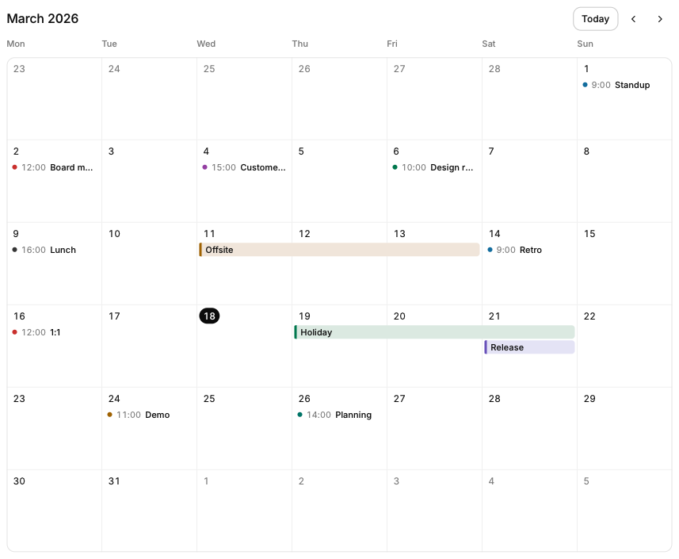

# Month calendar

Use a month calendar to browse appointments, holidays and days off. The
gallery shows timed events in order, bars for multi-day events and a
count of additional appointments when a day is full. Available in **GUI**.



## Example

```pascal
unit Docs.Ui.Planning.MonthCalendar;

uses Fpas.Ui.Elements as E;
uses Fpas.Ui.Widgets.Planning.MonthCalendars as W;
uses System as Sys;

// Shows the current month and its appointments.
// ## Parameters
// - `Current`: Displayed month, selected date and appointment array.
// ## Returns
// The calendar with navigation and activation proposals.
public function View(Current: W.Value): E.Element of W.Event;
begin
  return W.MonthCalendar of W.Event('release-calendar', Current,
    function(Change: W.Event): W.Event => Change);
end function;

// Creates a three-day appointment in March.
// ## Returns
// The appointment, with an inclusive final date.
public function Offsite(): W.Appointment;
begin
  return new W.Appointment('Offsite', new Sys.DateOnly(2026, 3, 9),
    new Sys.DateOnly(2026, 3, 11), AllDay := true);
end function;

end unit;
```

## Options and defaults

| Option | Default or requirement |
| --- | --- |
| `Value.Month / Selected` | Supply a date in the displayed month. The day is ignored. Selection defaults to null. |
| `Appointment.Finish` | Null. A finish date is inclusive. An unset or earlier finish gives a one-day event. |
| `Appointment.Time / AllDay / Tone` | 9 fractional hours / false / neutral. All-day and multi-day events use bars. |
| `FirstWeekday` | Zero for Monday. Use six for Sunday. |
| `CellHeight` | Zero for 104 logical units. The compact grid uses 46 logical units. |
| `MonthNames / DayNames` | Empty. For custom names, supply twelve months from January and seven weekdays from Monday. |
| `Hour12` | False for 24-hour time. True displays labels such as `9:30a`. |
| `Today / Enabled` | Null / true. Null Today uses the local system date. |

## Interaction

Adopt the proposed month and selected date in your update. Use
`MonthChanged` to load appointments for a different month and `DayActivated`
to open the selected day. A nonnegative `Activated` indexes an appointment
in the array supplied to the widget.

Click a date to select it. Double-click to activate it. Use the arrows to
move the keyboard cursor and Home to go to Today. Page Up and Page Down
keep the day of month where possible and select the last day in shorter
months. Space selects the keyboard date and Enter activates it. Focusing
the grid keeps the displayed month.

Click +N more to open the day's event list when the grid is full. Below
520 logical units, the grid shows colored dots and lists the selected
day's events underneath.

## Date values

The displayed month, selected day and events use `System.DateOnly`.
The calendar proposes dates from 0001-01-01 through 9999-12-31.
Set `Today` to override the local date for an application time zone or a test.
Convert `System.DateTime.Today` with `DateOnly.FromDateTime` to read the
local date in the application.

Use `DateOnly.AddDays` for calendar arithmetic. CUI day numbers count
from 1970-01-01. Subtract 719162 from `DateOnly.DayNumber` to get that
day number. Add 719162 before calling `DateOnly.FromDayNumber` to
convert back within the supported range.

## See also

- [CUI widget inventory](../../../cui-widget-inventory.md#cui_month_calendar)
- [Widget API and types](../../../../src/Fpas.Ui/Widgets/Planning/MonthCalendars.fpas)
- [Gallery example](../../../../examples/ui/gui/gallery/Pages/Planning/View.fpas)
- [Week calendar](week-calendar.md)
- [Planning](README.md)

## Source files

- `src/Fpas.Ui.Gui/Internal/Widgets/Planning/`
  - [MonthCalendar.fpas](../../../../src/Fpas.Ui.Gui/Internal/Widgets/Planning/MonthCalendar.fpas)
- `src/Fpas.Ui.Gui.Cui/Interop/Planning/`
  - [NativeMethods.MonthCalendar.Types.cs](../../../../src/Fpas.Ui.Gui.Cui/Interop/Planning/NativeMethods.MonthCalendar.Types.cs)
  - [NativeMethods.MonthCalendar.cs](../../../../src/Fpas.Ui.Gui.Cui/Interop/Planning/NativeMethods.MonthCalendar.cs)
- `src/Fpas.Ui.Gui.Cui/Widgets/Planning/`
  - [CuiWindow.MonthCalendar.Types.cs](../../../../src/Fpas.Ui.Gui.Cui/Widgets/Planning/CuiWindow.MonthCalendar.Types.cs)
  - [CuiWindow.MonthCalendar.cs](../../../../src/Fpas.Ui.Gui.Cui/Widgets/Planning/CuiWindow.MonthCalendar.cs)
- `src/Fpas.Ui.Gui.Cui/native/widgets/planning/`
  - [month_calendar.c](../../../../src/Fpas.Ui.Gui.Cui/native/widgets/planning/month_calendar.c)
  - [month_calendar.h](../../../../src/Fpas.Ui.Gui.Cui/native/widgets/planning/month_calendar.h)
- [Native planning tests](../../../../src/Fpas.Ui.Gui.Cui/native/tests/planning.c)
