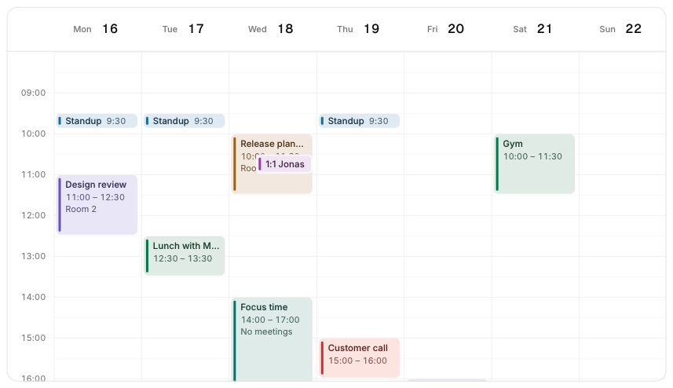

# Week calendar

Use a week calendar to schedule timed events across seven days. The gallery
shows overlapping meetings, calls and blocks of focus time. Available in **GUI**.



## Example

```pascal
unit Docs.Ui.Planning.WeekCalendar;

uses Fpas.Ui.Elements as E;
uses Fpas.Ui.Layout as L;
uses Fpas.Ui.Styles as S;
uses Fpas.Ui.Widgets.Planning.WeekCalendars as W;
uses System as Sys;

// Shows the supplied week and appointments.
// ## Parameters
// - `Week`: First day on display.
// - `Appointments`: Model-owned events, in stable order during edits.
// ## Returns
// The calendar with activation and schedule proposals.
public function View(Week: Sys.DateOnly; Appointments: array of W.Appointment): E.Element of W.Event;
begin
  return W.WeekCalendar of W.Event('week', new W.Value(Week, Appointments),
    function(Change: W.Event): W.Event => Change,
    new W.Options(StartHour := 8.0F, EndHour := 19.0F,
      Height := L.Extent.Fixed(L.Measure.Logical(420))));
end function;

// Creates an appointment for the first day.
// ## Returns
// A standup from 09:30 to 09:45.
public function Standup(): W.Appointment;
begin
  return new W.Appointment('Standup', 0, 9.5F, 9.75F, 'Zoom', S.Tone.Info);
end function;

end unit;
```

## Options and defaults

| Option | Default or requirement |
| --- | --- |
| `Week` | First visible date. The next six dates follow it. |
| `Appointment.Day / Start / Finish` | Day zero means `Week`. Supply increasing fractional hours between zero and 24. |
| `Appointment.Title / Detail` | Supply a title and a nullable detail. CUI shows details when the event has room. |
| `Appointment.Tone` | `Neutral`. CUI uses the current accent for this tone. |
| `StartHour / EndHour` | 7 / 21. Sets the visible part of each day. |
| `HourHeight` | Zero selects 52 logical units per hour. |
| `Height` | `Content` selects a 460-unit time grid. |
| `ReadOnly` | False. True keeps activation and scrolling and disables edits. |
| `Enabled` | True. False disables calendar input. |

## Interaction

Drag an event to move it in 15-minute increments. Drag its bottom edge to
resize. Use Left and Right to change the day of a focused event. Use Up and
Down to move its time, or hold Shift to resize it.

Keep the events in stable order during edits. Adopt `Event.Events` to
accept an edit. If a move would place hours outside the day, the event
keeps its original hours. A click, Enter or Space reports the event
index in `Activated`.

The day headers stay above the scrolling time grid. A narrow calendar
scrolls horizontally. CUI marks the current date and local time when visible.

## See also

- [CUI widget inventory](../../../cui-widget-inventory.md#cui_week_calendar)
- [Widget API and types](../../../../src/Fpas.Ui/Widgets/Planning/WeekCalendars.fpas)
- [Gallery example](../../../../examples/ui/gui/gallery/Pages/Planning/View.fpas)
- [Month calendar](month-calendar.md)
- [Planning](README.md)

## Source files

- `src/Fpas.Ui.Gui/Internal/Widgets/Planning/`
  - [WeekCalendar.fpas](../../../../src/Fpas.Ui.Gui/Internal/Widgets/Planning/WeekCalendar.fpas)
- `src/Fpas.Ui.Gui.Cui/Interop/Planning/`
  - [NativeMethods.WeekCalendar.Types.cs](../../../../src/Fpas.Ui.Gui.Cui/Interop/Planning/NativeMethods.WeekCalendar.Types.cs)
  - [NativeMethods.WeekCalendar.cs](../../../../src/Fpas.Ui.Gui.Cui/Interop/Planning/NativeMethods.WeekCalendar.cs)
- `src/Fpas.Ui.Gui.Cui/Widgets/Planning/`
  - [CuiWindow.WeekCalendar.Types.cs](../../../../src/Fpas.Ui.Gui.Cui/Widgets/Planning/CuiWindow.WeekCalendar.Types.cs)
  - [CuiWindow.WeekCalendar.cs](../../../../src/Fpas.Ui.Gui.Cui/Widgets/Planning/CuiWindow.WeekCalendar.cs)
- `src/Fpas.Ui.Gui.Cui/native/widgets/planning/`
  - [week_calendar.c](../../../../src/Fpas.Ui.Gui.Cui/native/widgets/planning/week_calendar.c)
  - [week_calendar.h](../../../../src/Fpas.Ui.Gui.Cui/native/widgets/planning/week_calendar.h)
