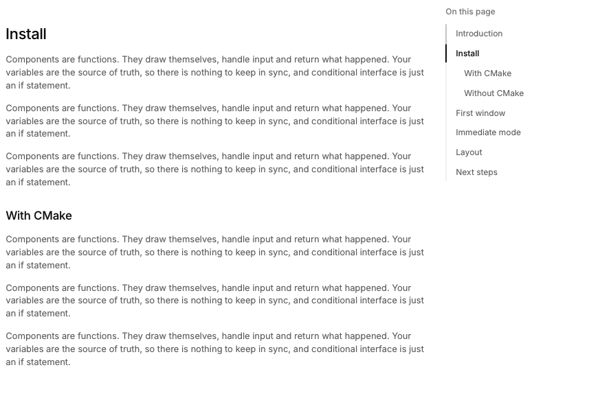

# Scroll anchor

The Reader screenshot shows the article after activating Install in the
outline. The Install marker sits before that heading inside the scroll view.
Available in **GUI**.



## Example

```pascal
unit Docs.Ui.Reader.ScrollAnchor;

uses
  Fpas.Ui.Elements as E, Fpas.Ui.Layout as L,
  Fpas.Ui.Widgets.Navigation.ScrollAnchors as W;

// Builds the viewport targeted by the outline example.
// ## Returns
// A scroll view with three anchored sections.
public function View(): E.Element<string>;
begin
  return E.Size<string>(
    E.ScrollView<string>('article', E.Column<string>(
      new L.Flow(Gap := L.Spacing.Normal),
      W.ScrollAnchor<string>('intro'), E.Text<string>('Introduction'),
      E.Gap<string>(L.Measure.Logical(180)),
      W.ScrollAnchor<string>('install'), E.Text<string>('Installation'),
      E.Gap<string>(L.Measure.Logical(180)),
      W.ScrollAnchor<string>('cmake'), E.Text<string>('With CMake'),
      E.Gap<string>(L.Measure.Logical(180))
    )),
    new L.Flex(Height := new L.AxisSize(Basis := L.Extent.Fixed(L.Measure.Logical(160))))
  );
end function;

end unit;
```

## Options and defaults

| Option | Default or requirement |
| --- | --- |
| `Id` | A nonempty, unique key that matches the corresponding outline entry. |

## Usage

Insert the marker immediately before the target content in an uncontrolled
scroll view. The marker has zero height. Give the scroll view a finite
height so the outline can move through its content.

## See also

- [Widget API and types](../../../../src/Fpas.Ui/Widgets/Navigation/ScrollAnchors.fpas)
- [Gallery example](../../../../examples/ui/gui/gallery/Pages/Reader/View.fpas)
- [Table of contents](table-of-contents.md)
- [Scroll view](../layout/scroll-view.md)
- [Chapter index](README.md)
