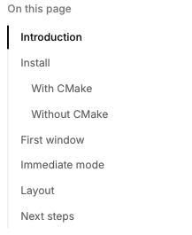

# Table of contents

Reader pairs an outline with a scrolling article. The outline indents nested
headings and marks the current section.
Available in **GUI**.



## Example

```pascal
unit Docs.Ui.Reader.TableOfContents;

uses Fpas.Ui.Elements as E;
uses Fpas.Ui.Widgets.Navigation.TableOfContents as W;

// Links an outline to the article viewport.
// ## Returns
// The outline, with the active anchor ID as a message.
public function View(): E.Element of string;
begin
  return W.TableOfContents of string('outline', 'article', [
    new W.Item('Introduction', 'intro'),
    new W.Item('Installation', 'install'),
    new W.Item('With CMake', 'cmake', 1)
  ], function(Anchor: string): string => Anchor);
end function;

end unit;
```

## Options and defaults

| Option | Default or requirement |
| --- | --- |
| `ScrollId` | The ID of an uncontrolled `ScrollView` in the same CUI scope. Each scroll view accepts one outline. |
| `Items` | One to 64 entries with nonempty titles. List them in the order of their anchors in the scroll view. |
| `Item.Anchor / Item.Level` | A distinct anchor ID for each entry and an indentation level from 0 to 4. Level defaults to 0. |
| `OnActiveChange / Enabled` | null / true. The callback observes changes after the initial frame. |

## Interaction

Click an entry or focus it and press Enter to scroll to its anchor. Use
`ItemId(Id, Index)` to request focus for an entry by its zero-based index.
As the article scrolls, CUI moves the active marker and updates the progress
rail. The GUI snapshot exposes the active anchor ID as the outline's value.

Place each marker inside the target scroll view. Keep the outline and its
target in the same CUI scope. A viewport inside a dialog cannot be targeted
by an outline outside the dialog.

## See also

- [Widget API and types](../../../../src/Fpas.Ui/Widgets/Navigation/TableOfContents.fpas)
- [Gallery example](../../../../examples/ui/gui/gallery/Pages/Reader/View.fpas)
- [Scroll anchor](scroll-anchor.md)
- [Scroll view](../layout/scroll-view.md)
- [Chapter index](README.md)

## Source files

- `src/Fpas.Ui.Gui/Internal/Widgets/Navigation/`
  - [TableOfContents.fpas](../../../../src/Fpas.Ui.Gui/Internal/Widgets/Navigation/TableOfContents.fpas)
- `src/Fpas.Ui.Gui.Cui/Interop/Navigation/`
  - [NativeMethods.TableOfContents.cs](../../../../src/Fpas.Ui.Gui.Cui/Interop/Navigation/NativeMethods.TableOfContents.cs)
- `src/Fpas.Ui.Gui.Cui/Widgets/Navigation/`
  - [CuiWindow.TableOfContents.cs](../../../../src/Fpas.Ui.Gui.Cui/Widgets/Navigation/CuiWindow.TableOfContents.cs)
- `src/Fpas.Ui.Gui.Cui/native/widgets/navigation/`
  - [table_of_contents.c](../../../../src/Fpas.Ui.Gui.Cui/native/widgets/navigation/table_of_contents.c)
  - [table_of_contents.h](../../../../src/Fpas.Ui.Gui.Cui/native/widgets/navigation/table_of_contents.h)
