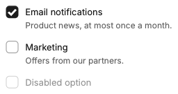

# Checkbox

Use a checkbox for an independent option, such as email notifications. Available in **GUI**.



## Example

```pascal
unit Docs.Ui.Selection.Checkbox;

uses Fpas.Ui.Elements as E, Fpas.Ui.Widgets.Inputs.Checkboxes as C;

// Builds the checkbox example.
// ## Parameters
// - `Checked`: Current value from the application model.
// ## Returns
// The widget for the application view.
public function View(Checked: bool): E.Element<bool>;
begin
  return C.Checkbox<bool>('newsletter', 'Email notifications', Checked,
    function(Value: bool): bool => Value, Description := 'Product news, at most once a month.');
end function;

end unit;
```

## Options and defaults

| Option | Default or requirement |
| --- | --- |
| `Checked` | Pass the Boolean from the model. |
| `Description` | Empty. Adds a second line beneath the label. |
| `Enabled` | true. |
| `Indeterminate` | false. On a checked box, true draws a dash. |
| `HideLabel` | false. Set true to draw only the box and retain the accessible label. |

## Interaction

Click the row or focus it with Tab and press Space or Enter. The callback receives the proposed Boolean. Store it in the model and pass it back on the next render.

## See also

- [Widget API and types](../../../../src/Fpas.Ui/Widgets/Inputs/Checkboxes.fpas)
- [Gallery example](../../../../examples/ui/gui/gallery/Pages/Selection/Widgets/Checkbox.fpas)
- [Switch](switch.md)
- [Selection](README.md)
