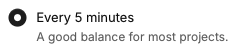

# Radio button

Use an individual radio button when your view lays out the choices itself. The screenshot shows a selected native row in the gallery's radio group. Available in **GUI**.



## Example

```pascal
unit Docs.Ui.Selection.RadioButton;

uses Fpas.Ui.Elements as E, Fpas.Ui.Widgets.Inputs.RadioButtons as C;

// Builds the radio button example.
// ## Parameters
// - `Selected`: Current value from the application model.
// ## Returns
// The widget for the application view.
public function View(Selected: bool): E.Element<string>;
begin
  return C.RadioButton<string>('save-periodic', 'Every 5 minutes', Selected,
    function(): string => 'periodic', Description := 'A good balance for most projects.');
end function;

end unit;
```

## Options and defaults

| Option | Default or requirement |
| --- | --- |
| `Selected` | Pass true for the choice currently held by the model. |
| `Description` | Empty. |
| `Enabled` | true. |

## Interaction

Click the row or activate it with Space or Enter while focused. The callback runs when an unselected row is activated. Keep one selection in the model and derive each row's Boolean from it.

## See also

- [Widget API and types](../../../../src/Fpas.Ui/Widgets/Inputs/RadioButtons.fpas)
- [Gallery example](../../../../examples/ui/gui/gallery/Pages/Selection/Widgets/RadioGroup.fpas)
- [Radio group](radio-group.md)
- [Selection](README.md)

## Source files

- `src/Fpas.Ui.Gui/Internal/Widgets/Inputs/`
  - [RadioButton.fpas](../../../../src/Fpas.Ui.Gui/Internal/Widgets/Inputs/RadioButton.fpas)
- `src/Fpas.Ui.Gui.Cui/Interop/Inputs/`
  - [NativeMethods.RadioButton.cs](../../../../src/Fpas.Ui.Gui.Cui/Interop/Inputs/NativeMethods.RadioButton.cs)
- `src/Fpas.Ui.Gui.Cui/Widgets/Inputs/`
  - [CuiWindow.RadioButton.cs](../../../../src/Fpas.Ui.Gui.Cui/Widgets/Inputs/CuiWindow.RadioButton.cs)
- `src/Fpas.Ui.Gui.Cui/native/widgets/inputs/`
  - [radio_button.c](../../../../src/Fpas.Ui.Gui.Cui/native/widgets/inputs/radio_button.c)
  - [radio_button.h](../../../../src/Fpas.Ui.Gui.Cui/native/widgets/inputs/radio_button.h)
