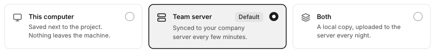

# Radio cards

Use radio cards when each exclusive choice needs a description, icon or badge. Available in **GUI**.



## Example

```pascal
unit Docs.Ui.Selection.RadioCards;

uses Fpas.Ui.Elements as E;
uses Fpas.Ui.Widgets.Inputs.RadioCards as C;

// Builds the radio cards example.
// ## Parameters
// - `Selected`: Current value from the application model.
// ## Returns
// The widget for the application view.
public function View(Selected: int): E.Element of int;
begin
  return C.RadioCards of int('places', [
    new C.Item('This computer', 'Saved next to the project.'),
    new C.Item('Team server', 'Synced to your company server.', Badge := 'Default'),
    new C.Item('Both', 'Keep both a local and a server copy.')
  ], Selected, function(Index: int): int => Index);
end function;

end unit;
```

## Options and defaults

| Option | Default or requirement |
| --- | --- |
| `Items` | A nonempty array. Description, icon and badge default to empty. |
| `Selected` | A zero-based index, or -1 for no selection. |
| `Columns` | 0 lets CUI choose. Set a positive value to cap the number of columns. |
| `Enabled` | true. |

## Interaction

Click a card or select it with Enter or Space. Arrow keys move focus and propose a new selection together. CUI reduces the number of columns as the available width shrinks. Use `ItemId(Id, Index)` to focus a particular card.

## See also

- [CUI widget inventory](../../../cui-widget-inventory.md#cui_radio_cards)
- [Widget API and types](../../../../src/Fpas.Ui/Widgets/Inputs/RadioCards.fpas)
- [Gallery example](../../../../examples/ui/gui/gallery/Pages/Selection/Widgets/RadioCards.fpas)
- [Radio group](radio-group.md)
- [Selection](README.md)

## Source files

- `src/Fpas.Ui.Gui/Internal/Widgets/Inputs/`
  - [RadioCards.fpas](../../../../src/Fpas.Ui.Gui/Internal/Widgets/Inputs/RadioCards.fpas)
- `src/Fpas.Ui.Gui.Cui/Interop/Inputs/`
  - [NativeMethods.RadioCards.cs](../../../../src/Fpas.Ui.Gui.Cui/Interop/Inputs/NativeMethods.RadioCards.cs)
- `src/Fpas.Ui.Gui.Cui/Widgets/Inputs/`
  - [CuiWindow.RadioCards.Types.cs](../../../../src/Fpas.Ui.Gui.Cui/Widgets/Inputs/CuiWindow.RadioCards.Types.cs)
  - [CuiWindow.RadioCards.cs](../../../../src/Fpas.Ui.Gui.Cui/Widgets/Inputs/CuiWindow.RadioCards.cs)
- `src/Fpas.Ui.Gui.Cui/native/widgets/inputs/`
  - [radio_cards.c](../../../../src/Fpas.Ui.Gui.Cui/native/widgets/inputs/radio_cards.c)
  - [radio_cards.h](../../../../src/Fpas.Ui.Gui.Cui/native/widgets/inputs/radio_cards.h)
