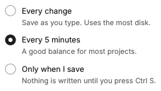

# Radio group

Use a radio group for exclusive choices in a vertical list. Available in **GUI** and [TUI](../../tui/selection/radio-group.md).



## Example

```pascal
unit Docs.Ui.Selection.RadioGroup;

uses Fpas.Ui.Elements as E;
uses Fpas.Ui.Widgets.Inputs.RadioGroups as C;

// Builds the radio group example.
// ## Parameters
// - `Selected`: Current value from the application model.
// ## Returns
// The widget for the application view.
public function View(Selected: int): E.Element<int>;
begin
  return C.RadioGroup<int>('save-frequency', [
    new C.Item('Every change', 'Save as you type. Uses the most disk.'),
    new C.Item('Every 5 minutes', 'A good balance for most projects.'),
    new C.Item('Only when I save')
  ], Selected, function(Index: int): int => Index);
end function;

end unit;
```

## Options and defaults

| Option | Default or requirement |
| --- | --- |
| `Items` | A nonempty array in display order. Each item has an optional description and is enabled by default. |
| `Selected` | A zero-based index, or -1 for no selection. |
| `Gap` | Ten logical points when omitted. |
| `Enabled` | true for the group. |

## Interaction

Click or activate an enabled row with Space or Enter to propose its index. Activating the selected row sends no message. Use `ItemId(Id, Index)` to address a row for focus.

## See also

- [Widget API and types](../../../../src/Fpas.Ui/Widgets/Inputs/RadioGroups.fpas)
- [Gallery example](../../../../examples/ui/gui/gallery/Shared/SaveFrequency.fpas)
- [Radio cards](radio-cards.md)
- [Selection](README.md)

## Source files

- [RadioGroup.fpas](../../../../src/Fpas.Ui.Gui/Internal/Widgets/Inputs/RadioGroup.fpas)
