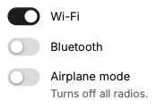

# Switch

Use a switch for an on/off setting such as Wi-Fi. Available in **GUI and TUI**.



## Example

```pascal
unit Docs.Ui.Selection.Switch;

uses Fpas.Ui.Elements as E;
uses Fpas.Ui.Widgets.Inputs.Switches as C;

// Builds the switch example.
// ## Parameters
// - `On`: Current value from the application model.
// ## Returns
// The widget for the application view.
public function View(On: bool): E.Element of bool;
begin
  return C.Switch of bool('wifi', 'Wi-Fi', On, function(Value: bool): bool => Value);
end function;

end unit;
```

## Options and defaults

| Option | Default or requirement |
| --- | --- |
| `On` | Pass the Boolean from the model. |
| `Description` | Empty. Adds a second line beneath the label. |
| `Enabled` | true. |

## Interaction

Click anywhere on the row, or press Space or Enter while it has focus. The callback receives the opposite of the displayed value.

## See also

- [Widget API and types](../../../../src/Fpas.Ui/Widgets/Inputs/Switches.fpas)
- [Gallery example](../../../../examples/ui/gui/gallery/Pages/Selection/Widgets/Switch.fpas)
- [Terminal switch](../../tui/selection/switch.md)
- [Checkbox](checkbox.md)
- [Selection](README.md)

## Source files

- [Shared gallery switch examples](../../../../examples/ui/gui/gallery/Shared/SwitchExamples.fpas)

- `src/Fpas.Ui.Gui/Internal/Widgets/Inputs/`
  - [Switch.fpas](../../../../src/Fpas.Ui.Gui/Internal/Widgets/Inputs/Switch.fpas)
- `src/Fpas.Ui.Gui.Cui/Interop/Inputs/`
  - [NativeMethods.Switch.cs](../../../../src/Fpas.Ui.Gui.Cui/Interop/Inputs/NativeMethods.Switch.cs)
- `src/Fpas.Ui.Gui.Cui/Widgets/Inputs/`
  - [CuiWindow.Switch.cs](../../../../src/Fpas.Ui.Gui.Cui/Widgets/Inputs/CuiWindow.Switch.cs)
- `src/Fpas.Ui.Gui.Cui/native/widgets/inputs/`
  - [switch.c](../../../../src/Fpas.Ui.Gui.Cui/native/widgets/inputs/switch.c)
  - [switch.h](../../../../src/Fpas.Ui.Gui.Cui/native/widgets/inputs/switch.h)
