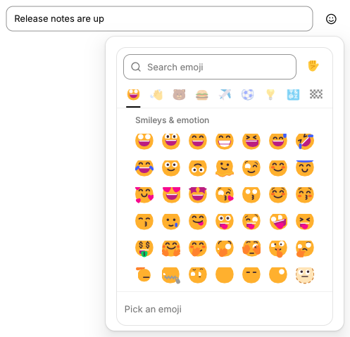

# Emoji picker

Smart inputs opens a native emoji palette beside the message field.
Available in **GUI**.



## Example

```pascal
unit Docs.Ui.SmartInputs.EmojiPicker;

uses Fpas.Ui.Elements as E;
uses Fpas.Ui.Layout as L;
uses Fpas.Ui.Widgets.Actions.IconButtons as B;
uses Fpas.Ui.Widgets.Inputs.TextFields as F;
uses Fpas.Ui.Widgets.Overlays.Menus as M;
uses Fpas.Ui.Widgets.Overlays.Popovers as P;
uses Fpas.Ui.Widgets.Pickers.EmojiPickers as W;
uses System as Sys;

// Messages for the field and its emoji palette.
public type Msg = variant
  // Accepts a text edit.
  Edit(Value: string);
  // Opens or dismisses the popover.
  SetOpen(Open: bool);
  // Applies a palette selection or skin tone change.
  ChangeEmoji(Change: W.Change);
end variant;

// Builds the message field and emoji popover.
// ## Parameters
// - `Text`: Current message text.
// - `Open`: Whether the popover is visible.
// - `Preferences`: Model-owned recent emoji and skin tone.
// ## Returns
// A row containing the field and anchored palette.
public function View(Text: string; Open: bool; Preferences: W.State): E.Element of Msg;
begin
  const Trigger: E.Element of Msg := B.IconButton of Msg(
    'emoji-trigger', Sys.Char.ConvertFromUtf32($E164), 'Emoji', Msg.SetOpen(not Open));
  const Picker: E.Element of Msg := W.EmojiPicker of Msg(
    'message-emoji', Preferences, Msg.ChangeEmoji, new W.Options(Height := 260.0F));
  return E.Row of Msg(
    new L.Flow(Gap := L.Spacing.Fixed(L.Measure.Logical(8)), Align := L.Alignment.Center),
    F.TextField of Msg('message', Text, Msg.Edit),
    P.Popover of Msg('emoji-popup', Trigger, Picker, Open, Msg.SetOpen(false),
      new P.Options(Position := M.Placement.BottomEnd, Width := 340))
  );
end function;

end unit;
```

## Options and defaults

| Option | Default or requirement |
| --- | --- |
| `State.Recent / Tone` | Empty / 0. History is space-separated, newest first, up to 255 UTF-8 bytes. Tone ranges from 0 to 5. |
| `Width / Height / Size` | All zero. CUI chooses the palette width, grid height and glyph size. |
| `Placeholder / EmptyText / Hint` | Empty. Override the search prompt, empty result text and preview hint. |
| `Search / Preview / ToneSelector / Enabled` | All true. |

## Interaction

Search by name or jump to a group. Accept `Change.Value` in the update
to keep history and skin tone. A tone change has a null `Change.Emoji`,
so the gallery keeps the palette open. When an emoji is selected, the
gallery appends it and closes the popover if the resulting message fits
the field's UTF-8 capacity.


## See also

- [CUI widget inventory](../../../cui-widget-inventory.md#cui_emoji_picker)
- [Widget API and types](../../../../src/Fpas.Ui/Widgets/Pickers/EmojiPickers.fpas)
- [Gallery example](../../../../examples/ui/gui/gallery/Pages/SmartInputs/Widgets/EmojiMessage.fpas)
- [Gallery update](../../../../examples/ui/gui/gallery/Pages/SmartInputs/Update.fpas)
- [Popover](../overlays/popover.md)
- [Emoji display](../text-and-display/emoji.md)
- [Smart inputs](README.md)

## Source files

- `src/Fpas.Ui.Gui/Internal/Widgets/Pickers/`
  - [EmojiPicker.fpas](../../../../src/Fpas.Ui.Gui/Internal/Widgets/Pickers/EmojiPicker.fpas)
- `src/Fpas.Ui.Gui.Cui/Interop/Pickers/`
  - [NativeMethods.EmojiPicker.cs](../../../../src/Fpas.Ui.Gui.Cui/Interop/Pickers/NativeMethods.EmojiPicker.cs)
- `src/Fpas.Ui.Gui.Cui/Widgets/Pickers/`
  - [CuiWindow.EmojiPicker.Types.cs](../../../../src/Fpas.Ui.Gui.Cui/Widgets/Pickers/CuiWindow.EmojiPicker.Types.cs)
  - [CuiWindow.EmojiPicker.cs](../../../../src/Fpas.Ui.Gui.Cui/Widgets/Pickers/CuiWindow.EmojiPicker.cs)
- `src/Fpas.Ui.Gui.Cui/native/widgets/pickers/`
  - [emoji_picker.c](../../../../src/Fpas.Ui.Gui.Cui/native/widgets/pickers/emoji_picker.c)
  - [emoji_picker.h](../../../../src/Fpas.Ui.Gui.Cui/native/widgets/pickers/emoji_picker.h)
- `tests/Fixtures/gui-host/`
  - [ColorEmojiContract.fpas](../../../../tests/Fixtures/gui-host/ColorEmojiContract.fpas)
