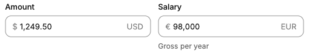

# Money field

The gallery shows a dollar amount with cents and a whole-euro salary.
Available in **GUI**.



## Example

```pascal
unit Docs.Ui.SmartInputs.MoneyField;

uses Fpas.Ui.Elements as E, Fpas.Ui.Widgets.Inputs.MoneyFields as W,
  System as Sys;

// Displays a whole-euro salary field.
// ## Parameters
// - `Salary`: Exact whole-euro amount.
// ## Returns
// A field that sends proposed amounts.
public function View(Salary: decimal): E.Element<decimal>;
requires Salary >= decimal.MinValue and Salary <= decimal.MaxValue;
begin
  if Sys.Decimal.Round(Salary, 0) <> Salary then
    raise new Sys.ArgumentException('The salary must be a whole-euro amount.');
  end if;

  return W.MoneyField<decimal>('salary', Salary,
    function(Proposed: decimal): decimal => Proposed,
    new W.Options(Label := 'Salary', Symbol := '€', Code := 'EUR',
      DecimalPlaces := 0, Hint := 'Gross per year'));
end function;

end unit;
```

## Options and defaults

| Option | Default or requirement |
| --- | --- |
| `Value` | CLR `decimal`, exactly representable at the selected fractional precision. |
| `Label / Hint` | Empty. Shown above and below the field. |
| `Symbol / Code` | $ / empty. These are literal captions. |
| `DecimalPlaces` | 2. Accepts 0 to 28 fractional digits. |
| `Width / Enabled` | Content / true. |

## Interaction

The field uses CUI's native text input with a currency prefix/suffix. CUI owns
layout, focus, cursor, selection, clipboard and undo. The CLR handles exact
decimal parsing and formatting; neither the model nor the native boundary
converts an amount to `double`.

At rest, amounts have comma grouping and the selected number of fractional
digits. Editing retains the typed draft, including incomplete signs or a trailing
decimal point. Use ASCII digits, an optional leading sign, a decimal point and
optional correctly grouped commas. This format is independent of CLR culture.

Only complete, exactly representable input produces a `decimal` proposal. Empty,
incomplete, malformed, overflowing or overly precise input leaves the amount
unchanged and shows native error feedback. Decimal parsing also rejects values
that .NET would otherwise round to fit its 96-bit coefficient. Enter or loss of
focus restores the accepted amount's formatted text. Type `0` to clear an amount.

Model replacements and rejected proposals reconcile the draft with the model.
Changing `DecimalPlaces` requires a model amount that fits the new precision;
round explicitly in application code when that is the intended operation.
The complete decimal range is supported. The editor allows 128 UTF-8 bytes,
which covers every formatted decimal amount at all supported precisions.

## See also

- [Widget API and types](../../../../src/Fpas.Ui/Widgets/Inputs/MoneyFields.fpas)
- [Gallery example](../../../../examples/ui/gui/gallery/Pages/SmartInputs/Widgets/Editors.fpas)
- [Number field](../inputs/number-field.md)
- [Smart inputs](README.md)

## Source files

- `src/Fpas.Ui.Gui/Internal/Widgets/Inputs/`
  - [MoneyField.fpas](../../../../src/Fpas.Ui.Gui/Internal/Widgets/Inputs/MoneyField.fpas)
- `src/Fpas.Ui.Gui.Cui/Interop/Inputs/`
  - [NativeMethods.MoneyField.cs](../../../../src/Fpas.Ui.Gui.Cui/Interop/Inputs/NativeMethods.MoneyField.cs)
- `src/Fpas.Ui.Gui.Cui/Widgets/Inputs/`
  - [CuiWindow.MoneyField.cs](../../../../src/Fpas.Ui.Gui.Cui/Widgets/Inputs/CuiWindow.MoneyField.cs)
  - [CuiWindow.MoneyState.cs](../../../../src/Fpas.Ui.Gui.Cui/Widgets/Inputs/CuiWindow.MoneyState.cs)
  - [MoneyAmounts.cs](../../../../src/Fpas.Ui.Gui.Cui/Widgets/Inputs/MoneyAmounts.cs)
- `src/Fpas.Ui.Gui.Cui/native/widgets/inputs/`
  - [money_field.c](../../../../src/Fpas.Ui.Gui.Cui/native/widgets/inputs/money_field.c)
  - [money_field.h](../../../../src/Fpas.Ui.Gui.Cui/native/widgets/inputs/money_field.h)
- `tests/Fixtures/gui-host/`
  - [MoneyDecimalContract.fpas](../../../../tests/Fixtures/gui-host/MoneyDecimalContract.fpas)
- `tests/Fpas.Ui.Gui.Cui.Tests/Inputs/`
  - [CuiMoneyFieldTests.cs](../../../../tests/Fpas.Ui.Gui.Cui.Tests/Inputs/CuiMoneyFieldTests.cs)
