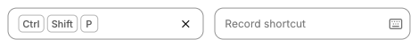

# Shortcut recorder

The gallery shows the command-palette shortcut beside an unbound search
shortcut. Available in **GUI**.



## Example

```pascal
unit Docs.Ui.SmartInputs.ShortcutRecorder;

uses Fpas.Ui.Elements as E;
uses Fpas.Ui.Widgets.Inputs.ShortcutRecorders as W;

// Supplies a command-palette shortcut for the initial model.
// ## Returns
// Control+Shift+P, with Command as the primary modifier on macOS.
public function DefaultShortcut(): W.Combination;
begin
  return new W.Combination(W.Key.P, W.PrimaryModifier() or W.Modifier.Shift);
end function;

// Edits an application shortcut.
// ## Parameters
// - `Current`: Key and modifiers from the model.
// ## Returns
// A recorder that sends a newly captured or cleared combination.
public function View(Current: W.Combination): E.Element of W.Combination;
begin
  return W.ShortcutRecorder of W.Combination('palette-key', Current,
    function(Proposed: W.Combination): W.Combination => Proposed,
    new W.Options(Placeholder := 'Record shortcut'));
end function;

// Displays the same combination in passive keycaps.
// ## Parameters
// - `Current`: Key and modifiers from the model.
// ## Returns
// A platform-formatted shortcut label.
public function Preview(Current: W.Combination): E.Element of W.Combination;
begin
  return W.Label of W.Combination(Current);
end function;

end unit;
```

## Options and defaults

| Option | Default or requirement |
| --- | --- |
| `Combination.Key / Modifiers` | None / None. Combine modifier flags with `or`. |
| `Placeholder` | Empty uses CUI's Click to record text. |
| `Width / Enabled` | Content / true. |

## Interaction

Click the recorder or focus it and press Enter or Space. Then press the
desired combination. Escape cancels, and unmodified Tab leaves recording.
While recording, unmodified Backspace or Delete clears the shortcut.
The clear button is available for an assigned combination.

The callback proposes the combination for the model. Use the recorded
value with the action that handles the shortcut. For a passive preview,
`Label` formats the same value as native keycaps.

## See also

- [Widget API and types](../../../../src/Fpas.Ui/Widgets/Inputs/ShortcutRecorders.fpas)
- [Gallery example](../../../../examples/ui/gui/gallery/Pages/SmartInputs/View.fpas)
- [Keycap](../text-and-display/keycap.md)
- [Keymap](../developer-tools/keymap.md)
- [Smart inputs](README.md)

## Source files

- `src/Fpas.Ui.Gui/Internal/Widgets/Inputs/`
  - [ShortcutRecorder.fpas](../../../../src/Fpas.Ui.Gui/Internal/Widgets/Inputs/ShortcutRecorder.fpas)
- `src/Fpas.Ui.Gui.Cui/Interop/Inputs/`
  - [NativeMethods.ShortcutRecorder.cs](../../../../src/Fpas.Ui.Gui.Cui/Interop/Inputs/NativeMethods.ShortcutRecorder.cs)
- `src/Fpas.Ui.Gui.Cui/Widgets/Inputs/`
  - [CuiWindow.ShortcutRecorder.Types.cs](../../../../src/Fpas.Ui.Gui.Cui/Widgets/Inputs/CuiWindow.ShortcutRecorder.Types.cs)
  - [CuiWindow.ShortcutRecorder.cs](../../../../src/Fpas.Ui.Gui.Cui/Widgets/Inputs/CuiWindow.ShortcutRecorder.cs)
- `src/Fpas.Ui.Gui.Cui/native/widgets/inputs/`
  - [shortcut_recorder.c](../../../../src/Fpas.Ui.Gui.Cui/native/widgets/inputs/shortcut_recorder.c)
  - [shortcut_recorder.h](../../../../src/Fpas.Ui.Gui.Cui/native/widgets/inputs/shortcut_recorder.h)
