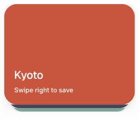

# Card stack

The gallery shows a destination deck. A completed swipe reports Saved
or Skipped and advances the model to the next card.
Available in **GUI**.



## Example

```pascal
unit Docs.Ui.SocialAndMedia.CardStack;

uses Fpas.Ui.Elements as E;
uses Fpas.Ui.Widgets.Containers.CardStacks as W;

// Shows a deck with the top card first.
// ## Parameters
// - `Cards`: Composed card views, front to back.
// ## Returns
// The deck with swipe directions as messages.
public function View(Cards: array of E.Element of W.Direction): E.Element of W.Direction;
begin
  return W.CardStack of W.Direction('destinations', Cards,
    function(Swipe: W.Direction): W.Direction => Swipe, new W.Options(Height := 200.0F));
end function;

end unit;
```

## Options and defaults

| Option | Default or requirement |
| --- | --- |
| `Width / Height / Visible` | Content / 0 / 0. Zero uses the native card height or visible count. |
| `Enabled` | true. Allows dismissing the top card. |

## Interaction

Flick the top card left or right, or dismiss it using the arrow keys.
Handle the reported direction and remove or rotate the top card in
the model.

## See also

- [CUI widget inventory](../../../cui-widget-inventory.md#cui_card_stack_begin)
- [Widget API and types](../../../../src/Fpas.Ui/Widgets/Containers/CardStacks.fpas)
- [Gallery example](../../../../examples/ui/gui/gallery/Pages/Social/Media.fpas)
- [Social and media](README.md)

## Source files

- `src/Fpas.Ui.Gui/Internal/Widgets/Containers/`
  - [CardStack.fpas](../../../../src/Fpas.Ui.Gui/Internal/Widgets/Containers/CardStack.fpas)
- `src/Fpas.Ui.Gui.Cui/Interop/Containers/`
  - [NativeMethods.CardStack.cs](../../../../src/Fpas.Ui.Gui.Cui/Interop/Containers/NativeMethods.CardStack.cs)
- `src/Fpas.Ui.Gui.Cui/Widgets/Containers/`
  - [CuiWindow.CardStack.cs](../../../../src/Fpas.Ui.Gui.Cui/Widgets/Containers/CuiWindow.CardStack.cs)
- `src/Fpas.Ui.Gui.Cui/native/widgets/containers/`
  - [card_stack.c](../../../../src/Fpas.Ui.Gui.Cui/native/widgets/containers/card_stack.c)
  - [card_stack.h](../../../../src/Fpas.Ui.Gui.Cui/native/widgets/containers/card_stack.h)
