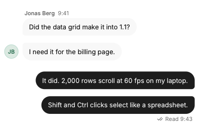

# Chat message

The gallery groups adjacent bubbles and shows a read receipt for the last
outgoing message.
Available in **GUI**.



## Example

```pascal
unit Docs.Ui.SocialAndMedia.ChatMessage;

uses Fpas.Ui.Elements as E;
uses Fpas.Ui.Widgets.Conversation.ChatMessages as W;

// Shows the final outgoing message in a group.
// ## Parameters
// - `Message`: Displayed message body.
// - `Receipt`: Current delivery or read status.
// ## Returns
// The chat bubble for the application view.
public function View(Message: string; Receipt: string): E.Element of string;
begin
  return W.ChatMessage of string('outgoing', Message,
    new W.Options(Mine := true, Grouped := true, LastInGroup := true, Status := Receipt));
end function;

end unit;
```

## Options and defaults

| Option | Default or requirement |
| --- | --- |
| `Mine / Grouped / LastInGroup` | All false. Mine selects the outgoing bubble. Grouped continues the previous group. LastInGroup displays its avatar or receipt at the end. |
| `Author / Time / Status / Avatar` | All empty. Avatar accepts a local image path. |
| `Markdown` | false. Enables formatting inside the bubble. |

## Interaction

Set Grouped and LastInGroup from the message order in your transcript.
The bubble is passive. For interactive Markdown link and task events, use
the standalone Markdown widget.

## See also

- [Widget API and types](../../../../src/Fpas.Ui/Widgets/Conversation/ChatMessages.fpas)
- [Gallery example](../../../../examples/ui/gui/gallery/Pages/Social/View.fpas)
- [Markdown](../code/markdown.md)
- [Chat divider](chat-divider.md)
- [Social and media](README.md)

## Source files

- `src/Fpas.Ui.Gui/Internal/Widgets/Conversation/`
  - [ChatMessage.fpas](../../../../src/Fpas.Ui.Gui/Internal/Widgets/Conversation/ChatMessage.fpas)
- `src/Fpas.Ui.Gui.Cui/Interop/Conversation/`
  - [NativeMethods.ChatMessage.cs](../../../../src/Fpas.Ui.Gui.Cui/Interop/Conversation/NativeMethods.ChatMessage.cs)
- `src/Fpas.Ui.Gui.Cui/Widgets/Conversation/`
  - [CuiWindow.ChatMessage.cs](../../../../src/Fpas.Ui.Gui.Cui/Widgets/Conversation/CuiWindow.ChatMessage.cs)
- `src/Fpas.Ui.Gui.Cui/native/widgets/conversation/`
  - [chat_message.c](../../../../src/Fpas.Ui.Gui.Cui/native/widgets/conversation/chat_message.c)
  - [chat_message.h](../../../../src/Fpas.Ui.Gui.Cui/native/widgets/conversation/chat_message.h)
