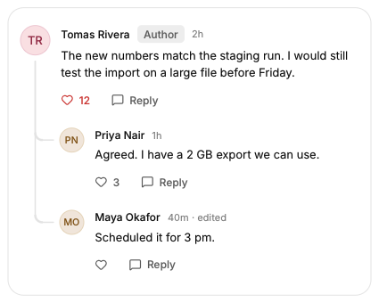

# Comment

The gallery uses reply indentation, an author badge and an edited marker.
Available in **GUI**.



## Example

```pascal
unit Docs.Ui.SocialAndMedia.Comment;

uses Fpas.Ui.Elements as E;
uses Fpas.Ui.Widgets.Conversation.Comments as W;

// Shows a reply with its current like state.
// ## Parameters
// - `Body`: Text of the reply.
// - `Current`: Model-owned like count and current user state.
// ## Returns
// The comment with Like and Reply proposals.
public function View(Body: string; Current: W.Value): E.Element of W.Event;
begin
  return W.Comment of W.Event('reply', 'Priya Nair', Body, Current,
    function(Change: W.Event): W.Event => Change, new W.Options(Depth := 1, Edited := true));
end function;

end unit;
```

## Options and defaults

| Option | Default or requirement |
| --- | --- |
| `Likes / Liked` | 0 / false. |
| `Depth / Edited` | 0 / false. Use Depth to indent replies. |
| `Time / Badge / Enabled` | Empty / empty / true. Badge appears beside the author. |

## Interaction

Persist the value from `Event.Like` for the correct comment. Handle
`Event.Reply` by opening or focusing the reply editor for that thread.

## See also

- [CUI widget inventory](../../../cui-widget-inventory.md#cui_comment)
- [Widget API and types](../../../../src/Fpas.Ui/Widgets/Conversation/Comments.fpas)
- [Gallery example](../../../../examples/ui/gui/gallery/Pages/Social/View.fpas)
- [Social and media](README.md)

## Source files

- `src/Fpas.Ui.Gui/Internal/Widgets/Conversation/`
  - [Comment.fpas](../../../../src/Fpas.Ui.Gui/Internal/Widgets/Conversation/Comment.fpas)
- `src/Fpas.Ui.Gui.Cui/Interop/Conversation/`
  - [NativeMethods.Comment.cs](../../../../src/Fpas.Ui.Gui.Cui/Interop/Conversation/NativeMethods.Comment.cs)
- `src/Fpas.Ui.Gui.Cui/Widgets/Conversation/`
  - [CuiWindow.Comment.cs](../../../../src/Fpas.Ui.Gui.Cui/Widgets/Conversation/CuiWindow.Comment.cs)
- `src/Fpas.Ui.Gui.Cui/native/widgets/conversation/`
  - [comment.c](../../../../src/Fpas.Ui.Gui.Cui/native/widgets/conversation/comment.c)
  - [comment.h](../../../../src/Fpas.Ui.Gui.Cui/native/widgets/conversation/comment.h)
