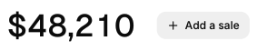

# Counter

Use a counter for a value that changes over time. The gallery adds a sale
to a revenue total with grouped thousands.
Available in **GUI**.



## Example

```pascal
unit Docs.Ui.SocialAndMedia.Counter;

uses Fpas.Ui.Elements as E, Fpas.Ui.Widgets.Feedback.Counters as W, Fpas.Ui.Widgets.Charts.Charts as C;

// Shows current revenue.
// ## Parameters
// - `Revenue`: Current total from the model.
// ## Returns
// The native counter.
public function View(Revenue: double): E.Element<string>;
begin
  return W.Counter<string>('revenue', Revenue,
    new W.Options(Format := new C.ValueFormat(Prefix := '$'),
      Size := 34.0F, GroupThousands := true));
end function;

end unit;
```

## Options and defaults

| Option | Default or requirement |
| --- | --- |
| `Format / Color` | null / Automatic. A value format controls precision and literal prefix or suffix. |
| `Size / GroupThousands` | 0 / false. Zero uses the native font size. GroupThousands separates thousands with commas. |

## Interaction

Pass a new value with the same ID when the total changes. CUI animates
the display to the new value. The button that changes the total belongs
to the application.

## See also

- [Widget API and types](../../../../src/Fpas.Ui/Widgets/Feedback/Counters.fpas)
- [Gallery example](../../../../examples/ui/gui/gallery/Pages/Social/View.fpas)
- [Countdown](../disclosure/countdown.md)
- [Social and media](README.md)

## Source files

- `src/Fpas.Ui.Gui/Internal/Widgets/Feedback/`
  - [Counter.fpas](../../../../src/Fpas.Ui.Gui/Internal/Widgets/Feedback/Counter.fpas)
- `src/Fpas.Ui.Gui.Cui/Interop/Feedback/`
  - [NativeMethods.Counter.cs](../../../../src/Fpas.Ui.Gui.Cui/Interop/Feedback/NativeMethods.Counter.cs)
- `src/Fpas.Ui.Gui.Cui/Widgets/Feedback/`
  - [CuiWindow.Counter.cs](../../../../src/Fpas.Ui.Gui.Cui/Widgets/Feedback/CuiWindow.Counter.cs)
- `src/Fpas.Ui.Gui.Cui/native/widgets/feedback/`
  - [counter.c](../../../../src/Fpas.Ui.Gui.Cui/native/widgets/feedback/counter.c)
  - [counter.h](../../../../src/Fpas.Ui.Gui.Cui/native/widgets/feedback/counter.h)
