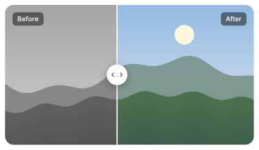

# Image compare

The gallery compares a grayscale landscape with its color version by
dragging the divider.
Available in **GUI**.



## Example

```pascal
unit Docs.Ui.SocialAndMedia.ImageCompare;

uses Fpas.Ui.Elements as E;
uses Fpas.Ui.Widgets.Media.ImageComparisons as W;
uses Fpas.Ui.Widgets.Media.MediaImages as M;

// Displays two images at the current divider position.
// ## Parameters
// - `Before`: Image to show before the divider.
// - `After`: Image to show after the divider.
// - `Divider`: Divider position from zero through one.
// ## Returns
// The comparison with a proposed divider fraction.
public function View(Before: M.Source; After: M.Source; Divider: float): E.Element of float;
begin
  return W.ImageCompare of float('before-after', Before, After, Divider,
    function(Position: float): float => Position, new W.Options(Height := 230.0F));
end function;

end unit;
```

## Options and defaults

| Option | Default or requirement |
| --- | --- |
| `Width / Height / Aspect` | Content / 0 / 0. Zero Aspect uses the first image's width-to-height ratio. |
| `BeforeLabel / AfterLabel / Enabled` | Before / After / true. |

## Interaction

Drag the divider or move it with the arrow keys. Store its proposed
fraction to keep the selected comparison in the model.

## See also

- [CUI widget inventory](../../../cui-widget-inventory.md#cui_image_compare)
- [Widget API and types](../../../../src/Fpas.Ui/Widgets/Media/ImageComparisons.fpas)
- [Gallery example](../../../../examples/ui/gui/gallery/Pages/Social/Media.fpas)
- [Social and media](README.md)

## Source files

- `src/Fpas.Ui.Gui/Internal/Widgets/Media/`
  - [ImageCompare.fpas](../../../../src/Fpas.Ui.Gui/Internal/Widgets/Media/ImageCompare.fpas)
- `src/Fpas.Ui.Gui.Cui/Interop/Media/`
  - [NativeMethods.ImageCompare.cs](../../../../src/Fpas.Ui.Gui.Cui/Interop/Media/NativeMethods.ImageCompare.cs)
- `src/Fpas.Ui.Gui.Cui/Widgets/Media/`
  - [CuiWindow.ImageCompare.cs](../../../../src/Fpas.Ui.Gui.Cui/Widgets/Media/CuiWindow.ImageCompare.cs)
- `src/Fpas.Ui.Gui.Cui/native/widgets/media/`
  - [image_compare.c](../../../../src/Fpas.Ui.Gui.Cui/native/widgets/media/image_compare.c)
  - [image_compare.h](../../../../src/Fpas.Ui.Gui.Cui/native/widgets/media/image_compare.h)
