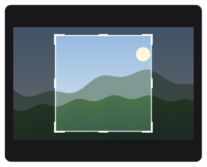

# Image cropper

The gallery previews a square crop on the same landscape as the viewer.
Available in **GUI**.



## Example

```pascal
unit Docs.Ui.SocialAndMedia.ImageCropper;

uses Fpas.Ui.Elements as E;
uses Fpas.Ui.Layout as L;
uses Fpas.Ui.Widgets.Media.ImageCroppers as W;
uses Fpas.Ui.Widgets.Media.MediaImages as M;

// Edits a square crop in source-image coordinates.
// ## Parameters
// - `Picture`: Local file or immutable RGBA image.
// - `Crop`: Current rectangle in image pixels.
// ## Returns
// The cropper with its proposed rectangle as a message.
public function View(Picture: M.Source; Crop: W.Value): E.Element of W.Value;
begin
  return W.ImageCropper of W.Value('crop', Picture, Crop,
    function(Change: W.Value): W.Value => Change,
    new W.Options(Height := L.Extent.Fixed(L.Measure.Logical(260)), Aspect := 1.0F));
end function;

end unit;
```

## Options and defaults

| Option | Default or requirement |
| --- | --- |
| `Value.X / Y / Width / Height` | All zero. A zero side requests a centered initial crop. |
| `Aspect` | Zero. Allow free resizing. A positive value sets the width divided by the height. |
| `Round` | False. Draw a circular mask and keep a square crop. |
| `MinimumSize` | Zero. Use a minimum side of 16 image pixels. The image bounds limit the minimum. |
| `Width / Height` | Content / Content. CUI fills the available width and uses a height of 360 logical units. |
| `Enabled` | True. Accept pointer and keyboard input. |

## Interaction

Drag inside the selection to move it. Drag a corner or edge to resize it.
Drag outside the selection to start a new crop. With the cropper focused,
the arrows move the selection by one image pixel. Hold Shift to move by
ten pixels.

The enabled cropper proposes the computed initial rectangle when you pass
a zero side. Store the proposed rectangle in the model. Use its image
coordinates to crop or export the source in your application.

## See also

- [CUI widget inventory](../../../cui-widget-inventory.md#cui_cropper)
- [Widget API and types](../../../../src/Fpas.Ui/Widgets/Media/ImageCroppers.fpas)
- [Gallery example](../../../../examples/ui/gui/gallery/Pages/Social/Media.fpas)
- [Social and media](README.md)

## Source files

- `src/Fpas.Ui.Gui/Internal/Widgets/Media/`
  - [ImageCropper.fpas](../../../../src/Fpas.Ui.Gui/Internal/Widgets/Media/ImageCropper.fpas)
- `src/Fpas.Ui.Gui.Cui/Interop/Media/`
  - [NativeMethods.ImageCropper.cs](../../../../src/Fpas.Ui.Gui.Cui/Interop/Media/NativeMethods.ImageCropper.cs)
- `src/Fpas.Ui.Gui.Cui/Widgets/Media/`
  - [CuiWindow.ImageCropper.cs](../../../../src/Fpas.Ui.Gui.Cui/Widgets/Media/CuiWindow.ImageCropper.cs)
- `src/Fpas.Ui.Gui.Cui/native/widgets/media/`
  - [image_cropper.c](../../../../src/Fpas.Ui.Gui.Cui/native/widgets/media/image_cropper.c)
  - [image_cropper.h](../../../../src/Fpas.Ui.Gui.Cui/native/widgets/media/image_cropper.h)
- [Native media tests](../../../../src/Fpas.Ui.Gui.Cui/native/tests/media.c)
