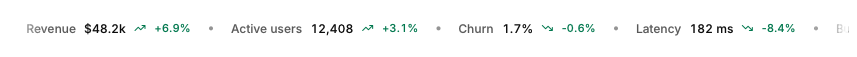

# Ticker

The gallery scrolls revenue, activity, churn, latency and other example figures.
Available in **GUI**.



## Example

```pascal
unit Docs.Ui.SocialAndMedia.Ticker;

uses Fpas.Ui.Elements as E;
uses Fpas.Ui.Widgets.Feedback.Tickers as W;

// Shows the current figures.
// ## Parameters
// - `Figures`: Labels, values and optional percent changes.
// ## Returns
// The native scrolling ticker.
public function View(Figures: array of W.Item): E.Element of string;
begin
  return W.Ticker of string('figures', Figures);
end function;

end unit;
```

## Options and defaults

| Option | Default or requirement |
| --- | --- |
| `Item.Value` | `null` omits the value position. An empty string keeps the position. |
| `Item.Delta / LowerIsBetter` | 0 / false. Zero Delta hides the trend. LowerIsBetter gives decreases the success color. |
| `Speed` | Zero uses 40 logical units per second. |
| `Height` | Zero uses 40 logical units. |

## Interaction

Hover over the ticker to pause it. When the GUI uses reduced motion, the
ticker stays still. Replace the list when your data changes. The ticker
repeats the entries to fill the visible width. [CUI-073](../../../future/cui-upstream-bugs.md#cui-073)

## See also

- [CUI widget inventory](../../../cui-widget-inventory.md#cui_ticker)
- [Widget API and types](../../../../src/Fpas.Ui/Widgets/Feedback/Tickers.fpas)
- [Gallery example](../../../../examples/ui/gui/gallery/Pages/Social/View.fpas)
- [Social and media](README.md)

## Source files

- `src/Fpas.Ui.Gui/Internal/Widgets/Feedback/`
  - [Ticker.fpas](../../../../src/Fpas.Ui.Gui/Internal/Widgets/Feedback/Ticker.fpas)
- `src/Fpas.Ui.Gui.Cui/Interop/Feedback/`
  - [NativeMethods.Ticker.Types.cs](../../../../src/Fpas.Ui.Gui.Cui/Interop/Feedback/NativeMethods.Ticker.Types.cs)
  - [NativeMethods.Ticker.cs](../../../../src/Fpas.Ui.Gui.Cui/Interop/Feedback/NativeMethods.Ticker.cs)
- `src/Fpas.Ui.Gui.Cui/Widgets/Feedback/`
  - [CuiWindow.Ticker.Types.cs](../../../../src/Fpas.Ui.Gui.Cui/Widgets/Feedback/CuiWindow.Ticker.Types.cs)
  - [CuiWindow.Ticker.cs](../../../../src/Fpas.Ui.Gui.Cui/Widgets/Feedback/CuiWindow.Ticker.cs)
- `src/Fpas.Ui.Gui.Cui/native/widgets/feedback/`
  - [ticker.c](../../../../src/Fpas.Ui.Gui.Cui/native/widgets/feedback/ticker.c)
  - [ticker.h](../../../../src/Fpas.Ui.Gui.Cui/native/widgets/feedback/ticker.h)
