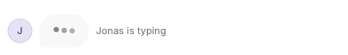

# Typing indicator

The gallery shows Jonas's name with the native typing dots.
Available in **GUI**.



## Example

```pascal
unit Docs.Ui.SocialAndMedia.TypingIndicator;

uses Fpas.Ui.Elements as E;
uses Fpas.Ui.Widgets.Conversation.TypingIndicators as W;

// Shows that a participant is typing.
// ## Parameters
// - `Participant`: Name to show while the user is typing.
// ## Returns
// The indicator for the conversation view.
public function View(Participant: string): E.Element of string;
begin
  return W.TypingIndicator of string('typing', Participant);
end function;

end unit;
```

## Options and defaults

| Option | Default or requirement |
| --- | --- |
| `Id / Name` | Supply a stable ID and the participant name. |

## Interaction

Render the indicator while the model reports typing and omit it when
typing stops. CUI animates the dots. Reduced motion keeps them still.

## See also

- [Widget API and types](../../../../src/Fpas.Ui/Widgets/Conversation/TypingIndicators.fpas)
- [Gallery example](../../../../examples/ui/gui/gallery/Pages/Social/View.fpas)
- [Chat message](chat-message.md)
- [Social and media](README.md)

## Source files

- `src/Fpas.Ui.Gui/Internal/Widgets/Conversation/`
  - [TypingIndicator.fpas](../../../../src/Fpas.Ui.Gui/Internal/Widgets/Conversation/TypingIndicator.fpas)
- `src/Fpas.Ui.Gui.Cui/Interop/Conversation/`
  - [NativeMethods.TypingIndicator.cs](../../../../src/Fpas.Ui.Gui.Cui/Interop/Conversation/NativeMethods.TypingIndicator.cs)
- `src/Fpas.Ui.Gui.Cui/Widgets/Conversation/`
  - [CuiWindow.TypingIndicator.cs](../../../../src/Fpas.Ui.Gui.Cui/Widgets/Conversation/CuiWindow.TypingIndicator.cs)
- `src/Fpas.Ui.Gui.Cui/native/widgets/conversation/`
  - [typing_indicator.c](../../../../src/Fpas.Ui.Gui.Cui/native/widgets/conversation/typing_indicator.c)
  - [typing_indicator.h](../../../../src/Fpas.Ui.Gui.Cui/native/widgets/conversation/typing_indicator.h)
