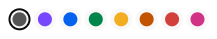
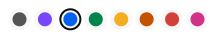

# Interactive canvas

The gallery draws eight selectable swatches. The ring marks the current choice.
Available in **GUI**.



## Example

```pascal
unit Docs.Ui.TextAndDisplay.Canvas;

uses
  Fpas.Ui.Elements as E, Fpas.Ui.Graphics as G, Fpas.Ui.Layout as L,
  Fpas.Ui.Widgets.Canvas.Canvases as W;

// Draws a swatch and reports the click in canvas coordinates.
// ## Parameters
// - `Fill`: Swatch color.
// ## Returns
// A 22-point square canvas with a circle.
public function View(Fill: G.Color): E.Element<W.Event>;
begin
  const Size: L.Extent := L.Extent.Fixed(L.Measure.Logical(22));
  return W.Canvas<W.Event>('color-swatch',
    [W.Shape.Circle(11.0F, 11.0F, 8.0F, Fill)],
    function(Click: W.Event): W.Event => Click,
    new W.Options(Width := Size, Height := Size, Focusable := true, HoverCursor := W.Cursor.Hand));
end function;

end unit;
```

## Options and defaults

| Option | Default or requirement |
| --- | --- |
| `Width / Height / Enabled` | Fill / 120 logical points / true. |
| `Drawing` | Rectangles, circles and lines in paint order. |
| `Paint` | null. An optional owner-thread callback draws after layout with the final canvas size. |
| `OnWheel / OnPointer` | Both null. Opt in to wheel ownership or changed hover and press notifications. |
| `Focusable / HoverCursor` | false / null. Opt in to native keyboard activation and choose a pointer shape while hovered. |
| `OnInput` | null. Supplying a handler makes the canvas focusable and routes component input to it. |

## Keyboard and pane focus

Use `Focusable := true` when Enter or Space should invoke the click action.
For a custom editor, pass `OnInput` to receive `Input.Key(Code, Modifiers, Down, Repeated)`,
`Input.Text(Value)` and `Input.WindowFocus(Focused)`. Use the text event for
committed Unicode. Key codes and modifier flags use the shared
`ShortcutRecorders.Key` and `ShortcutRecorders.Modifier` types. When a click
or Tab moves focus between canvases, subsequent text in that batch goes to the
new owner. A key handled by the canvas does not also activate its click action.
Request focus from Update with `Mvu.Focus<TMsg>(Id)`. A passive live-resize view
preserves a canvas's focus eligibility and defers application input to the next
interactive frame. When queued messages temporarily suspend input, the
focused canvas keeps its native focus until input resumes. If a managed input callback throws, the window
discards the current frame and its remaining input, then propagates the original
exception. A subsequent `NextFrame()` starts a fresh view.

Set `Scope := new L.FocusScope('inspector', true)` on a row, column or layered
container to limit Tab and Shift+Tab to a pane. Give each pane a stable ID
and mark the currently active pane. Inactive panes remain clickable. With
no active pane, Tab visits unscoped controls. Open modals take precedence.

## Interaction

The click message carries the pointer position and canvas size in local
logical points. In the gallery, each swatch maps its click to a selection
index. The update stores that index and the next view draws its ring.

Use [custom canvas painting](../canvas-and-bars/painting.md) for text,
images and other drawing primitives, or to observe pointer and wheel input.



## See also

- [Widget API and types](../../../../src/Fpas.Ui/Widgets/Canvas/Canvases.fpas)
- [Gallery example](../../../../examples/ui/gui/gallery/Pages/Display/View.fpas)
- [Canvas and bars](../canvas-and-bars/README.md)
- [Chapter index](README.md)

## Source files

- `src/Fpas.Ui.Gui/Internal/Widgets/Canvas/`
  - [Canvas.fpas](../../../../src/Fpas.Ui.Gui/Internal/Widgets/Canvas/Canvas.fpas)
- `src/Fpas.Ui.Gui.Cui/Interop/Canvas/`
  - [NativeMethods.Canvas.cs](../../../../src/Fpas.Ui.Gui.Cui/Interop/Canvas/NativeMethods.Canvas.cs)
- `src/Fpas.Ui.Gui.Cui/Widgets/Canvas/`
  - [CuiWindow.Canvas.Types.cs](../../../../src/Fpas.Ui.Gui.Cui/Widgets/Canvas/CuiWindow.Canvas.Types.cs)
  - [CuiWindow.CanvasInput.cs](../../../../src/Fpas.Ui.Gui.Cui/Widgets/Canvas/CuiWindow.CanvasInput.cs)
  - [CuiWindow.Canvas.cs](../../../../src/Fpas.Ui.Gui.Cui/Widgets/Canvas/CuiWindow.Canvas.cs)
- `src/Fpas.Ui.Gui.Cui/native/widgets/canvas/`
  - [canvas.c](../../../../src/Fpas.Ui.Gui.Cui/native/widgets/canvas/canvas.c)
  - [canvas.h](../../../../src/Fpas.Ui.Gui.Cui/native/widgets/canvas/canvas.h)
- `tests/Fpas.Ui.Gui.Cui.Tests/Display/`
  - [CuiCanvasInputTests.cs](../../../../tests/Fpas.Ui.Gui.Cui.Tests/Display/CuiCanvasInputTests.cs)
  - [CuiCanvasWin32InputTests.cs](../../../../tests/Fpas.Ui.Gui.Cui.Tests/Display/CuiCanvasWin32InputTests.cs)
  - [CuiCanvasWheelTests.cs](../../../../tests/Fpas.Ui.Gui.Cui.Tests/Display/CuiCanvasWheelTests.cs)
