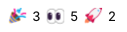

# Emoji

The gallery pairs three emoji with reaction counts.
Available in **GUI**.



## Example

```pascal
unit Docs.Ui.TextAndDisplay.Emoji;

uses Fpas.Ui.Elements as E;
uses Fpas.Ui.Layout as L;
uses Fpas.Ui.Widgets.Display.Emojis as W;

// Displays a celebration emoji and its count.
// ## Parameters
// - `Count`: Current reaction count.
// ## Returns
// The emoji and its adjacent count.
public function View(Count: int): E.Element of string;
begin
  return E.Row of string(
    new L.Flow(Gap := L.Spacing.Fixed(L.Measure.Logical(6)), Align := L.Alignment.Center),
    W.Emoji of string('🎉', 18.0F),
    E.Text of string(Count.ToString())
  );
end function;

end unit;
```

## Options and defaults

| Option | Default or requirement |
| --- | --- |
| `Glyph` | A Unicode emoji sequence. |
| `Size` | 0 uses the native size in logical points. |

## Usage

Use Emoji to display a glyph. The model supplies any count or label beside
it. Use Emoji picker when the user should choose a glyph.

## See also

- [Widget API and types](../../../../src/Fpas.Ui/Widgets/Display/Emojis.fpas)
- [Gallery example](../../../../examples/ui/gui/gallery/Pages/Display/View.fpas)
- [Emoji picker](../smart-inputs/emoji-picker.md)
- [Chapter index](README.md)

## Source files

- `src/Fpas.Ui.Gui/Internal/Widgets/Display/`
  - [Emoji.fpas](../../../../src/Fpas.Ui.Gui/Internal/Widgets/Display/Emoji.fpas)
- `src/Fpas.Ui.Gui.Cui/Interop/Display/`
  - [NativeMethods.Emoji.cs](../../../../src/Fpas.Ui.Gui.Cui/Interop/Display/NativeMethods.Emoji.cs)
- `src/Fpas.Ui.Gui.Cui/Widgets/Display/`
  - [CuiWindow.Emoji.cs](../../../../src/Fpas.Ui.Gui.Cui/Widgets/Display/CuiWindow.Emoji.cs)
- `src/Fpas.Ui.Gui.Cui/native/widgets/display/`
  - [emoji.c](../../../../src/Fpas.Ui.Gui.Cui/native/widgets/display/emoji.c)
  - [emoji.h](../../../../src/Fpas.Ui.Gui.Cui/native/widgets/display/emoji.h)
