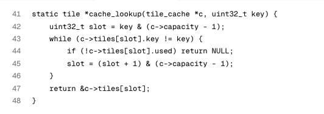

# Formatted text

App chrome draws the editor sample and line numbers in the native monospace
face. Available in **GUI**.



## Example

```pascal
unit Docs.Ui.TextAndDisplay.FormattedText;

uses Fpas.Ui.Elements as E;
uses Fpas.Ui.Layout as L;
uses Fpas.Ui.Graphics as G;
uses Fpas.Ui.Widgets.Theming.Themes as T;

// Draws one line from the editor preview.
// ## Parameters
// - `LineNumber`: Line number to display at the left.
// - `Content`: The source line.
// - `Colors`: Current theme colors.
// ## Returns
// One row of two explicitly formatted labels.
public function View(LineNumber: int; Content: string; Colors: T.Palette): E.Element of string;
begin
  return E.Row of string(
    new L.Flow(Gap := L.Spacing.Fixed(L.Measure.Logical(18))),
    E.FormattedText of string(LineNumber.ToString(), G.Font.Mono, 12.0F, Colors.TextMuted),
    E.FormattedText of string(Content, G.Font.Mono, 12.0F, Colors.Foreground)
  );
end function;

end unit;
```

## Options and defaults

| Option | Default or requirement |
| --- | --- |
| `Text / Font` | Supply the visible text and a `Graphics.Font` role. Use Body, Medium, Display, Mono or Icons. |
| `Size` | Logical font size. Zero uses the theme size. |
| `Color` | Supply a straight-alpha color. Use the current palette to follow the host appearance. |
| `Settings` | `Texts.Options` defaults to inherited reading direction and Start alignment. |
| `NoWrap` | False. True keeps text on one line and shows the full text on hover if CUI truncates it. |
| `Width` | Content. Set Fill, Fixed or Percent to give CUI an explicit text width for layout and alignment. |
| `LineHeight` | Zero uses the native line height multiplier of 1.45. Supply a positive multiplier to change line spacing. |
| `Tabular` | False. Set true for equal digit advances in layout, drawing and the truncation calculation. |

## Usage

Use this label when the view needs an exact face, size and color. For
semantic headings and captions, use the text roles on the Text page.
Both APIs use the same [reading direction and alignment options](text.md).

Use [sizing](../../layout/sizing.md) for width bounds and growth weights.
Use [font assignment](../host.md#fonts-and-native-captions) to load and apply a different face to a role.
CUI reserves the native `selectable` field. The widget displays static text.

## See also

- [CUI widget inventory](../../../cui-widget-inventory.md#cui_text)
- [Widget API and types](../../../../src/Fpas.Ui/Elements.fpas)
- [Gallery example](../../../../examples/ui/gui/gallery/Pages/Desktop/Editor.fpas)
- [Native font roles](../../../../src/Fpas.Ui/Graphics.fpas)
- [Text](text.md)
- [Text and display](README.md)

## Source files

- [Presentation.fpas](../../../../src/Fpas.Ui.Gui/Internal/Presentation/Presentation.fpas)
