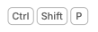

# Keycap

The gallery renders the command-palette hint as three keycaps.
Available in **GUI**.



## Example

```pascal
unit Docs.Ui.TextAndDisplay.Keycap;

uses Fpas.Ui.Elements as E;
uses Fpas.Ui.Widgets.Display.Keycaps as W;

// Shows the command-palette shortcut hint.
// ## Returns
// Three native keycaps.
public function View(): E.Element<string>;
begin
  return W.Keycap<string>('Ctrl Shift P');
end function;

end unit;
```

## Options and defaults

| Option | Default or requirement |
| --- | --- |
| `Keys` | Space-separated key labels. |

## Usage

Keycaps are labels. Register or configure the actual shortcut on the
widget or application action that handles it.

## See also

- [Widget API and types](../../../../src/Fpas.Ui/Widgets/Display/Keycaps.fpas)
- [Gallery example](../../../../examples/ui/gui/gallery/Pages/Display/View.fpas)
- [Command palette](../overlays/command-palette.md)
- [Chapter index](README.md)

## Source files

- `src/Fpas.Ui.Gui/Internal/Widgets/Display/`
  - [Keycap.fpas](../../../../src/Fpas.Ui.Gui/Internal/Widgets/Display/Keycap.fpas)
- `src/Fpas.Ui.Gui.Cui/Interop/Display/`
  - [NativeMethods.Keycap.cs](../../../../src/Fpas.Ui.Gui.Cui/Interop/Display/NativeMethods.Keycap.cs)
- `src/Fpas.Ui.Gui.Cui/Widgets/Display/`
  - [CuiWindow.Keycap.cs](../../../../src/Fpas.Ui.Gui.Cui/Widgets/Display/CuiWindow.Keycap.cs)
- `src/Fpas.Ui.Gui.Cui/native/widgets/display/`
  - [keycap.c](../../../../src/Fpas.Ui.Gui.Cui/native/widgets/display/keycap.c)
  - [keycap.h](../../../../src/Fpas.Ui.Gui.Cui/native/widgets/display/keycap.h)
