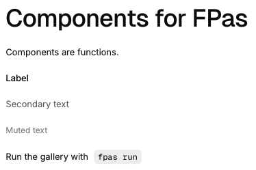

# Text

The gallery shows a heading, body copy, label, secondary text, muted text
and inline code.
Available in **GUI**.



## Example

```pascal
unit Docs.Ui.TextAndDisplay.Text;

uses Fpas.Ui.Elements as E, Fpas.Ui.Styles as S, Fpas.Ui.Widgets.Display.Texts as W;

// Shows a heading with an inline command hint.
// ## Returns
// Native text elements in a column.
public function View(): E.Element<string>;
begin
  return E.Column<string>(
    W.Text<string>('Quickstart', W.Appearance.HeadingOne),
    E.Row<string>(
      W.Text<string>('Run', W.Appearance.Body),
      W.Text<string>('fpas run', W.Appearance.Code)
    )
  );
end function;

// Adds a theme-provided display title like the Overview heading.
// ## Parameters
// - `Caption`: The visible heading.
// ## Returns
// A label styled with the graphical display title role.
public function Title(Caption: string): E.Element<string>;
begin
  return E.Styled<string>(E.Text<string>(Caption), S.Role.DisplayTitle);
end function;

end unit;
```

## Options and defaults

| Option | Default or requirement |
| --- | --- |
| `Role` | Pass Body, HeadingOne through HeadingFour, Label, Secondary, Muted or Code. |

## Usage

Use Body for wrapping paragraphs and Code for a compact monospaced span.
Place the code span in a row with the surrounding text. For a label shared
between hosts, use `Elements.Text`.

Apply `Elements.Styled` to a label when its appearance should follow a
semantic role from the theme. Overview uses `DisplayTitle` for its main
heading and `Introduction` for the paragraph beneath it.

## See also

- [Widget API and types](../../../../src/Fpas.Ui/Widgets/Display/Texts.fpas)
- [Gallery example](../../../../examples/ui/gui/gallery/Pages/Display/View.fpas)
- [Code block](../code/code-block.md)
- [Formatted text](formatted-text.md)
- [Overview](../overview/README.md)
- [Chapter index](README.md)
- [Terminal example](../../tui/text-and-display/text.md)
