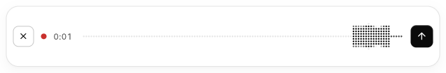

# Composer

Use a composer for text or voice messages. The Voice gallery switches
from a text draft to a recorder with levels and elapsed time.
Available in **GUI**.


## Example

```pascal
unit Docs.Ui.Voice.Composer;

uses Fpas.Ui.Elements as E;
uses Fpas.Ui.Widgets.Ai.Composers as W;

// Shows a message composer with optional recording.
// ## Parameters
// - `Draft`: Current draft, attachments, model options and optional recording.
// ## Returns
// The composer with draft and action proposals.
public function View(Draft: W.Value): E.Element of W.Event;
begin
  return W.Composer of W.Event('message', Draft, function(Change: W.Event): W.Event => Change,
    new W.Options(Placeholder := 'Message', Microphone := true, MaxUtf8Bytes := 255));
end function;

end unit;
```

## Options and defaults

| Value field | Default and behavior |
| --- | --- |
| `Draft` | Empty text. Use LF for line breaks. |
| `Attachments` | Empty array. Supply file names in display order. Each chip has a Remove action in both modes. |
| `Models` | Empty array. Supply model items to show a picker in text mode. |
| `Selected` | Zero. Supply the zero-based index of the current model, or zero when there are no models. |
| `Busy` | `false`. Set to `true` to replace Send with Stop in text mode. The draft remains editable. |
| `Take` | Null shows the text editor. Set a `Recording` to show Cancel, a recording indicator, elapsed time, a waveform, and Send. |

| Option | Default and behavior |
| --- | --- |
| `Width` | `Fill`. Use `Content` to fit the controls. Use `Fixed` or `Percent` to set an explicit width. |
| `Placeholder` | Null shows `Ask anything`. An empty string hides the placeholder. |
| `MaxLines` | Zero uses eight visible lines. The editor scrolls when the draft exceeds the visible line limit. |
| `MaxUtf8Bytes` | 511. Set a positive limit up to 1,048,576 UTF-8 bytes, excluding the terminator. |
| `Microphone` | `false`. Set to `true` to show the Record action in text mode. |
| `Enabled` | `true`. Set to `false` to disable editing and actions. |

Pass `Recording.Levels` in chronological order with the newest sample last.
Levels range from zero to one. Negative levels down to `Voice.Silent` (-1)
show silence. Pass finite, nonnegative elapsed seconds in `Recording.Seconds`.

## Proposals

The application owns the draft, attachments, model, and recording.
Apply or handle each proposal in the application.

| Proposal | Result |
| --- | --- |
| `Edit(Draft)` | The editor changed the draft. |
| `Send(Draft)` | Submit the edited draft. The composer emits `Edit` first if the draft also changed in the same frame. |
| `Stop` | Stop generation. |
| `Attach` | Choose a file to attach. |
| `Remove(Index)` | Remove the attachment at the zero-based index. |
| `Select(Index)` | Use the model at the zero-based index. |
| `Record` | Start a take and supply its recording preview. |
| `Cancel` | Discard the take and clear `Take`. Cancel takes precedence if Send activates in the same frame. |
| `SendVoice` | Submit the take and clear `Take`. The draft stays in the model. |

## Interaction

Press Enter in the editor to submit. Use Shift+Enter to add a line.
Send requires content beyond spaces, tabs, and line breaks. While busy,
activate Stop to request cancellation. Enter in the editor keeps the draft open.
Use the arrow keys to navigate the model menu, Enter to choose, and Escape to close.

To direct focus, use `/editor`, `/send`, `/record`, `/cancel`, `/attach`,
`/model`, or `/remove/<index>` after the composer ID. Availability follows
the current mode and options. `/send` identifies the Stop button while busy.

Activate Record to request a take. When Cancel or Send has focus, Escape
cancels the take. The application handles microphone capture and supplies
recording levels. The gallery supplies synthetic recorder levels.



The AI page supplies a model menu and attached file names in the same composer.


## See also

- [CUI widget inventory](../../../cui-widget-inventory.md#cui_chat_composer)
- [Widget API and types](../../../../src/Fpas.Ui/Widgets/Ai/Composers.fpas)
- [Gallery example](../../../../examples/ui/gui/gallery/Pages/Voice/View.fpas)
- [Voice note](voice-note.md)
- [AI model picker](../ai/model-picker.md)
- [AI gallery](../../../../examples/ui/gui/gallery/Pages/Ai/View.fpas)
- [Gallery recording update](../../../../examples/ui/gui/gallery/Pages/Voice/Update.fpas)
- [Voice](README.md)

## Source files

- [ComposerParts.fpas](../../../../src/Fpas.Ui/Internal/Ai/ComposerParts.fpas)
- `src/Fpas.Ui.Gui/Internal/Widgets/Ai/`
  - [Composer.fpas](../../../../src/Fpas.Ui.Gui/Internal/Widgets/Ai/Composer.fpas)
- `src/Fpas.Ui.Gui.Cui/Interop/Ai/`
  - [NativeMethods.Composer.cs](../../../../src/Fpas.Ui.Gui.Cui/Interop/Ai/NativeMethods.Composer.cs)
- `src/Fpas.Ui.Gui.Cui/Widgets/Ai/`
  - [CuiWindow.Composer.Types.cs](../../../../src/Fpas.Ui.Gui.Cui/Widgets/Ai/CuiWindow.Composer.Types.cs)
  - [CuiWindow.Composer.cs](../../../../src/Fpas.Ui.Gui.Cui/Widgets/Ai/CuiWindow.Composer.cs)
- `src/Fpas.Ui.Gui.Cui/native/widgets/ai/`
  - [composer.c](../../../../src/Fpas.Ui.Gui.Cui/native/widgets/ai/composer.c)
  - [composer.h](../../../../src/Fpas.Ui.Gui.Cui/native/widgets/ai/composer.h)
- `src/Fpas.Ui.Gui.Cui/native/tests/`
  - [voice_composer.c](../../../../src/Fpas.Ui.Gui.Cui/native/tests/voice_composer.c)
