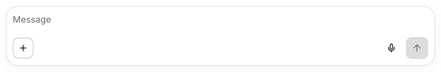
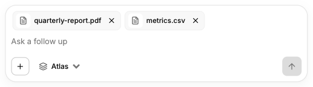

# Composer

Use a composer for text or voice messages. The Voice gallery switches
from a text draft to a recorder with levels and elapsed time.
Available in **GUI**.



## Example

```pascal
unit Docs.Ui.Voice.Composer;

uses Fpas.Ui.Elements as E;
uses Fpas.Ui.Widgets.Ai.Composers as W;

// Shows a message composer with optional recording.
// ## Parameters
// - `Draft`: Current draft, attachments, model options and optional recording.
// ## Returns
// The composer with draft and action proposals.
public function View(Draft: W.Value): E.Element of W.Event;
begin
  return W.Composer of W.Event('message', Draft, function(Change: W.Event): W.Event => Change,
    new W.Options(Placeholder := 'Message', Microphone := true, MaxUtf8Bytes := 255));
end function;

end unit;
```

## Options and defaults

| Option | Default or requirement |
| --- | --- |
| `Value.Draft / Attachments / Models` | Empty text and empty arrays. Attachments show removable file names. A nonempty Models array shows a picker. |
| `Selected / Busy / Take` | 0 / false / null. Selected is a zero-based model index. Busy replaces Send with Stop. Set Take to show recording controls. |
| `Width / Placeholder` | Fill / null. Null shows the native “Ask anything” prompt. An empty string hides the prompt. |
| `MaxLines / MaxUtf8Bytes` | 0 / 511. Zero uses eight visible lines. The byte limit excludes the terminator. Use LF for line breaks. |
| `Microphone / Enabled` | false / true. Microphone adds the record action in text mode. |

## Interaction

Press Enter in the editor to submit. Use Shift+Enter to add a line. The
composer sends `Edit` before `Send` when both occur in one frame. While busy,
the Stop button sends `Stop` and Enter in the editor leaves the draft open.

Handle `Attach`, `Remove` and `Select` in the application. `Remove` and
`Select` report zero-based indices into their input arrays. To direct
focus, use `/editor`, `/send`, `/record`, `/cancel`, `/attach`, `/model`
or `/remove/<index>` after the composer ID. Availability follows the current
mode and model list. `/send` identifies the Stop button while busy.

On `Record`, create a take with levels in chronological order and elapsed
seconds. When Cancel or Send has focus, Escape cancels the take. Handle
`Cancel` by discarding the take and `SendVoice` by submitting it. The
gallery supplies synthetic recorder levels.


The AI page supplies a model menu and attached file names in the same composer.



## See also

- [CUI widget inventory](../../../cui-widget-inventory.md#cui_chat_composer)
- [Widget API and types](../../../../src/Fpas.Ui/Widgets/Ai/Composers.fpas)
- [Gallery example](../../../../examples/ui/gui/gallery/Pages/Voice/View.fpas)
- [Voice note](voice-note.md)
- [AI model picker](../ai/model-picker.md)
- [AI gallery](../../../../examples/ui/gui/gallery/Pages/Ai/View.fpas)
- [Gallery recording update](../../../../examples/ui/gui/gallery/Pages/Voice/Update.fpas)
- [Voice](README.md)

## Source files

- [ComposerParts.fpas](../../../../src/Fpas.Ui/Internal/Ai/ComposerParts.fpas)
- `src/Fpas.Ui.Gui/Internal/Widgets/Ai/`
  - [Composer.fpas](../../../../src/Fpas.Ui.Gui/Internal/Widgets/Ai/Composer.fpas)
- `src/Fpas.Ui.Gui.Cui/Interop/Ai/`
  - [NativeMethods.Composer.cs](../../../../src/Fpas.Ui.Gui.Cui/Interop/Ai/NativeMethods.Composer.cs)
- `src/Fpas.Ui.Gui.Cui/Widgets/Ai/`
  - [CuiWindow.Composer.Types.cs](../../../../src/Fpas.Ui.Gui.Cui/Widgets/Ai/CuiWindow.Composer.Types.cs)
  - [CuiWindow.Composer.cs](../../../../src/Fpas.Ui.Gui.Cui/Widgets/Ai/CuiWindow.Composer.cs)
- `src/Fpas.Ui.Gui.Cui/native/widgets/ai/`
  - [composer.c](../../../../src/Fpas.Ui.Gui.Cui/native/widgets/ai/composer.c)
  - [composer.h](../../../../src/Fpas.Ui.Gui.Cui/native/widgets/ai/composer.h)
