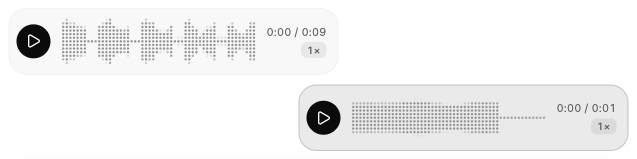

# Voice note

Use a voice note to show a recording with playback controls. The gallery shows
an incoming note and can add an outgoing one from its simulated recorder.
Available in **GUI**.



## Example

```pascal
unit Docs.Ui.Voice.VoiceNote;

uses Fpas.Ui.Elements as E;
uses Fpas.Ui.Widgets.Audio.VoiceNotes as W;

// Shows a voice note at the current playback position.
// ## Parameters
// - `Levels`: Normalized waveform levels.
// - `Playback`: Current duration, position, speed and playing state.
// ## Returns
// The note with transport and speed proposals.
public function View(Levels: array of float; Playback: W.Value): E.Element of W.Event;
begin
  return W.VoiceNote of W.Event('message', Levels, Playback,
    function(Change: W.Event): W.Event => Change);
end function;

end unit;
```

## Options and defaults

| Option | Default or requirement |
| --- | --- |
| `Levels` | Supply clip levels oldest first, from 0 to 1. Use `Voice.Silent` for a silent sample. |
| `Duration` | Supply the nonnegative clip length in seconds. A zero-length clip has a passive waveform. |
| `Position` | Zero seconds. Supply the current position between zero and `Duration`. |
| `Speed` | 1. Supported rates are 1, 1.5 and 2. Zero displays as 1. |
| `Playing` | `false` shows Play. Set `true` to show Pause. |
| `Width` | `Content` uses up to 330 logical units. `Fill`, `Fixed`, and `Percent` set an explicit extent. |
| `Mine` | `false` shows an incoming note. Set `true` to tint the bubble and move it to the end. |
| `Enabled` | `true` lets the note accept playback, seek, and speed input. |

The controls can wrap in narrow bubbles. Right-to-left layout mirrors the
bubble. The waveform always shows time from left to right.

## Interaction

The application owns playback and supplies the current position each frame.
The gallery simulates playback with its clock.

| Proposal | When the GUI host sends it |
| --- | --- |
| `Toggle(Playing)` | The user activates Play or Pause. The value is the proposed playback state. |
| `Seek(Position)` | The user seeks in the waveform. The value is the proposed position in seconds. |
| `Speed(Rate)` | The user activates the speed chip. The chip cycles through 1, 1.5 and 2. |

Click or drag the waveform to seek. When it has focus, Left and Right seek by
one second. Home and End seek to the start and end of the clip.

Tab moves through Play, the seekable waveform, and the speed chip. Use Enter
or Space on Play, Pause, or the speed chip. For a GUI `Focus` request, use the
note ID for Play or append `/play`, `/seek`, or `/speed` to select a part.

## See also

- [CUI widget inventory](../../../cui-widget-inventory.md#cui_voice_note)
- [Widget API and types](../../../../src/Fpas.Ui/Widgets/Audio/VoiceNotes.fpas)
- [Gallery example](../../../../examples/ui/gui/gallery/Pages/Voice/View.fpas)
- [Composer](composer.md)
- [Voice waveform](voice-waveform.md)
- [Gallery playback update](../../../../examples/ui/gui/gallery/Pages/Voice/Update.fpas)
- [Voice](README.md)

## Source files

- `src/Fpas.Ui.Gui/Internal/Widgets/Audio/`
  - [VoiceNote.fpas](../../../../src/Fpas.Ui.Gui/Internal/Widgets/Audio/VoiceNote.fpas)
- `src/Fpas.Ui.Gui.Cui/Interop/Audio/`
  - [NativeMethods.VoiceNote.cs](../../../../src/Fpas.Ui.Gui.Cui/Interop/Audio/NativeMethods.VoiceNote.cs)
- `src/Fpas.Ui.Gui.Cui/Widgets/Audio/`
  - [CuiWindow.VoiceNote.Types.cs](../../../../src/Fpas.Ui.Gui.Cui/Widgets/Audio/CuiWindow.VoiceNote.Types.cs)
  - [CuiWindow.VoiceNote.cs](../../../../src/Fpas.Ui.Gui.Cui/Widgets/Audio/CuiWindow.VoiceNote.cs)
- `src/Fpas.Ui.Gui.Cui/native/widgets/audio/`
  - [voice_note.c](../../../../src/Fpas.Ui.Gui.Cui/native/widgets/audio/voice_note.c)
  - [voice_note.h](../../../../src/Fpas.Ui.Gui.Cui/native/widgets/audio/voice_note.h)
- `src/Fpas.Ui.Gui.Cui/native/tests/`
  - [voice_note.c](../../../../src/Fpas.Ui.Gui.Cui/native/tests/voice_note.c)
