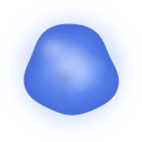

# Voice orb

The gallery includes CUI's legacy voice orb and toggles it between Idle
and Listening.
Available in **GUI**.


## Example

```pascal
unit Docs.Ui.Voice.VoiceOrb;

uses Fpas.Ui.Elements as E;
uses Fpas.Ui.Widgets.Audio.Voice as V;
uses Fpas.Ui.Widgets.Audio.VoiceOrbs as W;

// Shows the current state of a voice control.
// ## Parameters
// - `Mode`: Current voice activity.
// - `Level`: Normalized current level from zero through one.
// ## Returns
// The orb with an activation message.
public function View(Mode: V.Activity; Level: float): E.Element of string;
begin
  return W.VoiceOrb of string('voice-orb', Mode, Level, function(): string => 'toggle-listening');
end function;

end unit;
```

## Options and defaults

| Option | Default or requirement |
| --- | --- |
| `Activity / Level` | Supply the activity and the latest normalized level. |
| `Activate / Enabled` | Supply a callback to handle activation or pass null for a passive orb. Enabled defaults to true. |
| `Size / Color` | 0 / Automatic. Zero uses the native diameter. |

## Interaction

Pass the newest activity and level to update the orb. With an activation
callback, use its message to handle the change in the application.



## See also

- [CUI widget inventory](../../../cui-widget-inventory.md#cui_voice_orb)
- [Widget API and types](../../../../src/Fpas.Ui/Widgets/Audio/VoiceOrbs.fpas)
- [Gallery example](../../../../examples/ui/gui/gallery/Pages/Voice/View.fpas)
- [Voice](README.md)

## Source files

- `src/Fpas.Ui.Gui/Internal/Widgets/Audio/`
  - [VoiceOrb.fpas](../../../../src/Fpas.Ui.Gui/Internal/Widgets/Audio/VoiceOrb.fpas)
- `src/Fpas.Ui.Gui.Cui/Interop/Audio/`
  - [NativeMethods.VoiceOrb.cs](../../../../src/Fpas.Ui.Gui.Cui/Interop/Audio/NativeMethods.VoiceOrb.cs)
- `src/Fpas.Ui.Gui.Cui/Widgets/Audio/`
  - [CuiWindow.VoiceOrb.cs](../../../../src/Fpas.Ui.Gui.Cui/Widgets/Audio/CuiWindow.VoiceOrb.cs)
- `src/Fpas.Ui.Gui.Cui/native/widgets/audio/`
  - [voice_orb.c](../../../../src/Fpas.Ui.Gui.Cui/native/widgets/audio/voice_orb.c)
  - [voice_orb.h](../../../../src/Fpas.Ui.Gui.Cui/native/widgets/audio/voice_orb.h)
