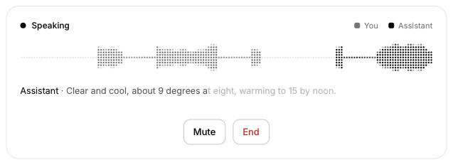

# Voice session

The gallery displays both voices on one timeline with a scripted transcript.
The timeline stays flat during the thinking pause.
Available in **GUI**.



## Example

```pascal
unit Docs.Ui.Voice.VoiceSession;

uses Fpas.Ui.Elements as E;
uses Fpas.Ui.Widgets.Audio.Voice as V;
uses Fpas.Ui.Widgets.Audio.VoiceSessions as W;

// Shows an active conversation and its latest transcript.
// ## Parameters
// - `Mode`: Current activity, such as Listening or Speaking.
// - `Signal`: Recent audio levels and optional speaker tags.
// - `Muted`: Current microphone state.
// - `Spoken`: Words spoken so far.
// ## Returns
// The session with mute and end-call proposals.
public function View(Mode: V.Activity; Signal: V.Signal; Muted: bool; Spoken: string): E.Element of W.Event;
begin
  return W.VoiceSession of W.Event('call', Mode, Signal, Muted,
    function(Change: W.Event): W.Event => Change, new W.Options(Transcript := Spoken));
end function;

end unit;
```

## Options and defaults

| Option | Default or requirement |
| --- | --- |
| `Activity` | Supply `Idle`, `Listening`, `Thinking`, `Speaking`, or `Muted`. These show Waiting, Listening, Thinking…, Speaking, or Muted. |
| `Signal` | Supply measured levels, oldest first. With no speaker tags, all levels use the caller color. |
| `Muted` | Supply the current microphone state. Pass `null` to omit Mute. |
| `Width` | `Fill`. Set a fixed or percentage width. `Content` also fills the available width. |
| `Label` | Empty. Supply text to replace the activity caption. |
| `You` | Empty. Supply a name to replace You in the legend and transcript. |
| `Assistant` | Empty. Supply a name to replace Assistant in the legend and transcript. |
| `Transcript` | `null`. Supply the words spoken so far. |
| `Upcoming` | `null`. Supply the words still to come. The session displays these words dimmed. |
| `Speaker` | `You`. Choose whose name precedes the transcript. |
| `HideEnd` | `false`. Set to `true` to omit End. |
| `Enabled` | `true`. Set to `false` to disable Mute and End. |

## Interaction

Update the signal and transcript as the conversation advances. For a
shared signal, supply one `You` or `Reply` tag per level. The caller and
assistant use different colors, as shown in the legend. Use `Voice.Silent`
to show a flat gap while the assistant thinks.

The timeline always runs left to right. The transcript appears when
either `Transcript` or `Upcoming` is supplied. The transcript reserves
space for two lines.

Tab moves through the available Mute and End buttons. Enter or Space
activates the focused button. The timeline is display-only.

## Results

`Mute(Muted)` proposes the new microphone state. Store it in the model
and apply it to the microphone. The button displays Unmute while the model
supplies `true`.

`EndCall` requests the end of the call. The application ends the call and
updates the displayed activity and signal.

## See also

- [CUI widget inventory](../../../cui-widget-inventory.md#cui_voice_session)
- [Widget API and types](../../../../src/Fpas.Ui/Widgets/Audio/VoiceSessions.fpas)
- [Gallery example](../../../../examples/ui/gui/gallery/Pages/Voice/View.fpas)
- [Voice waveform](voice-waveform.md)
- [Gallery voice script](../../../../examples/ui/gui/gallery/Pages/Voice/Script.fpas)
- [Voice](README.md)

## Source files

- `src/Fpas.Ui.Gui.Cui/native/tests/`
  - [voice_session.c](../../../../src/Fpas.Ui.Gui.Cui/native/tests/voice_session.c)
- `src/Fpas.Ui.Gui/Internal/Widgets/Audio/`
  - [VoiceSession.fpas](../../../../src/Fpas.Ui.Gui/Internal/Widgets/Audio/VoiceSession.fpas)
- `src/Fpas.Ui.Gui.Cui/Interop/Audio/`
  - [NativeMethods.VoiceSession.cs](../../../../src/Fpas.Ui.Gui.Cui/Interop/Audio/NativeMethods.VoiceSession.cs)
- `src/Fpas.Ui.Gui.Cui/Widgets/Audio/`
  - [CuiWindow.VoiceSession.Types.cs](../../../../src/Fpas.Ui.Gui.Cui/Widgets/Audio/CuiWindow.VoiceSession.Types.cs)
  - [CuiWindow.VoiceSession.cs](../../../../src/Fpas.Ui.Gui.Cui/Widgets/Audio/CuiWindow.VoiceSession.cs)
- `src/Fpas.Ui.Gui.Cui/native/widgets/audio/`
  - [voice_session.c](../../../../src/Fpas.Ui.Gui.Cui/native/widgets/audio/voice_session.c)
  - [voice_session.h](../../../../src/Fpas.Ui.Gui.Cui/native/widgets/audio/voice_session.h)
