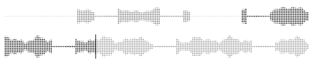

# Voice waveform

The gallery shows a scrolling live strip and a separate clip with a seek position.
Available in **GUI**.



## Example

```pascal
unit Docs.Ui.Voice.VoiceWaveform;

uses Fpas.Ui.Elements as E;
uses Fpas.Ui.Widgets.Audio.Voice as V;
uses Fpas.Ui.Widgets.Audio.VoiceWaves as W;

// Shows a recorded clip with a seek position.
// ## Parameters
// - `Signal`: Clip levels and optional speaker tags.
// - `Progress`: Fraction played from zero through one.
// ## Returns
// The waveform with proposed seek fractions.
public function View(Signal: V.Signal; Progress: float): E.Element of float;
begin
  return W.VoiceWave of float('voice-clip', Signal, Progress,
    function(Next: float): float => Next, new W.Options(Clip := true));
end function;

end unit;
```

## Options and defaults

| Option | Default or requirement |
| --- | --- |
| `Signal.Levels / Owners` | Levels are normalized, newest last for live data. Use Voice.Silent for silence. Optional byte tags use Voice.Owner and match the length of Levels. |
| `Progress / Clip` | Pass a progress fraction for seeking. Clip defaults to false. Setting it true fits the entire clip. |
| `Width / Pitch / Step` | Fill / 0 / 0. Zero Pitch or Step uses native dot spacing or keyboard seek increment. |
| `Owner / Color / Enabled` | You / Automatic / true. Owner applies when the signal has no speaker tags. |

## Interaction

Pass null for the progress and callback to display a passive live strip.
Supply a progress fraction and mapper to accept pointer and keyboard
seeks. Apply the proposed fraction to your clip's playback state.

## See also

- [CUI widget inventory](../../../cui-widget-inventory.md#cui_voice_wave)
- [Widget API and types](../../../../src/Fpas.Ui/Widgets/Audio/VoiceWaves.fpas)
- [Gallery example](../../../../examples/ui/gui/gallery/Pages/Voice/View.fpas)
- [Voice note](voice-note.md)
- [Voice session](voice-session.md)
- [Voice](README.md)

## Source files

- `src/Fpas.Ui.Gui/Internal/Widgets/Audio/`
  - [VoiceWave.fpas](../../../../src/Fpas.Ui.Gui/Internal/Widgets/Audio/VoiceWave.fpas)
- `src/Fpas.Ui.Gui.Cui/Interop/Audio/`
  - [NativeMethods.VoiceWave.cs](../../../../src/Fpas.Ui.Gui.Cui/Interop/Audio/NativeMethods.VoiceWave.cs)
- `src/Fpas.Ui.Gui.Cui/Widgets/Audio/`
  - [CuiWindow.VoiceWave.cs](../../../../src/Fpas.Ui.Gui.Cui/Widgets/Audio/CuiWindow.VoiceWave.cs)
- `src/Fpas.Ui.Gui.Cui/native/widgets/audio/`
  - [voice_wave.c](../../../../src/Fpas.Ui.Gui.Cui/native/widgets/audio/voice_wave.c)
  - [voice_wave.h](../../../../src/Fpas.Ui.Gui.Cui/native/widgets/audio/voice_wave.h)
