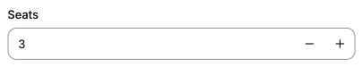

# Number field

Use a number field for a bounded numeric value that the user can type or step up and down. Available in **GUI**.



## Example

```pascal
unit Docs.Ui.Inputs.NumberField;

uses Fpas.Ui.Elements as E, Fpas.Ui.Widgets.Inputs.NumberFields as W;

// Builds the number field example.
// ## Parameters
// - `Seats`: Current value from the application model.
// ## Returns
// The widget for the application view.
public function View(Seats: double): E.Element<double>;
begin
  return W.NumberField<double>('input-seats', Seats, 0.0, 99.0,
    function(Value: double): double => Value, new W.Options(Label := 'Seats'));
end function;

end unit;
```

## Options and defaults

| Option | Default or requirement |
| --- | --- |
| `Value / Minimum / Maximum` | Finite doubles. The bounds are inclusive. |
| `Label / Suffix` | Empty. The suffix displays units beside the editor. |
| `Step` | 1.0. Supply a finite positive increment. |
| `DecimalPlaces` | 0. Accepts 0 through 15. |
| `Enabled` | true. |

## Interaction

Type a complete finite number or use the step buttons or arrow keys. Shift with an arrow applies ten steps. The adapter clamps the proposal to the bounds. Enter or loss of focus refreshes the displayed value. Use `DecreaseId(Id)` and `IncreaseId(Id)` to identify the buttons.

## See also

- [Widget API and types](../../../src/Fpas.Ui/Widgets/Inputs/NumberFields.fpas)
- [Gallery example](../../../examples/ui/gui/gallery/Pages/Inputs/Widgets/PickerFields.fpas)
- [Inputs](README.md)
