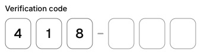

# One-time code input

Use a one-time code input for a short verification code made of ASCII letters or digits. Available in **GUI**.



## Example

```pascal
unit Docs.Ui.Inputs.OneTimeCode;

uses Fpas.Ui.Elements as E, Fpas.Ui.Widgets.Inputs.OneTimeCodes as W;

// Builds the one-time code input example.
// ## Parameters
// - `Code`: Current value from the application model.
// ## Returns
// The widget for the application view.
public function View(Code: string): E.Element<string>;
begin
  return W.OneTimeCodeInput<string>('input-code', Code, function(Value: string): string => Value,
    new W.Options(Label := 'Verification code'));
end function;

end unit;
```

## Options and defaults

| Option | Default or requirement |
| --- | --- |
| `Value` | The current partial or complete code. |
| `Length` | 6. Accepts 1 through 12. |
| `Label / Enabled` | Empty / true. |
| `OnComplete` | Optional callback for a newly entered complete code. |

## Interaction

Typing appends a character, Backspace removes the last character and paste
replaces the code. When an edit completes the code, the host sends the change
before the completion message. Pasting a different complete code also sends
completion. Repeating the same paste sends no second event. GUI snapshots
expose only the entered length.

## See also

- [Widget API and types](../../../src/Fpas.Ui/Widgets/Inputs/OneTimeCodes.fpas)
- [Gallery example](../../../examples/ui/gui/gallery/Pages/Inputs/Widgets/CredentialFields.fpas)
- [Inputs](README.md)
