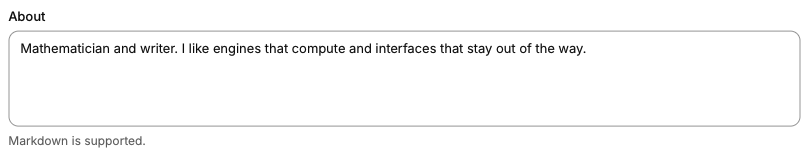

# Text area

Use a text area for wrapping multiline text, such as a profile description. Available in **GUI**.



## Example

```pascal
unit Docs.Ui.Inputs.TextArea;

uses Fpas.Ui.Elements as E, Fpas.Ui.Widgets.Inputs.TextAreas as W;

// Builds the text area example.
// ## Parameters
// - `About`: Current value from the application model.
// ## Returns
// The widget for the application view.
public function View(About: string): E.Element<string>;
begin
  return W.TextArea<string>('input-about', About, function(Value: string): string => Value,
    new W.Options(Label := 'About', Hint := 'Markdown is supported.', MaxUtf8Bytes := 511));
end function;

end unit;
```

## Options and defaults

| Option | Default or requirement |
| --- | --- |
| `Value` | Use LF line endings. |
| `Height` | 96 logical points. Zero uses CUI's default. A negative value fills the available height. |
| `Label / Placeholder / Icon / Hint / Error` | Empty. Error replaces Hint. |
| `Prefix / Suffix` | Empty. Affixes stay outside the editable text. |
| `Clearable / ReadOnly / Enabled` | false / false / true. |
| `ControlSize / MaxUtf8Bytes` | Medium / 4095. |

## Interaction

Enter inserts LF. Ctrl+Enter invokes the optional submission callback on Windows and Linux. Up and Down move between visual lines. The wheel scrolls the field until it reaches an edge, then scrolls the enclosing viewport.

## See also

- [Widget API and types](../../../src/Fpas.Ui/Widgets/Inputs/TextAreas.fpas)
- [Gallery example](../../../examples/ui/gui/gallery/Pages/Inputs/Widgets/TextArea.fpas)
- [Inputs](README.md)
