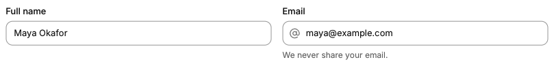

# Text field

Use a text field for a single line of editable text. The gallery shows a name field and an email field with an icon and hint. Available in **GUI**.



## Example

```pascal
unit Docs.Ui.Inputs.TextField;

uses Fpas.Ui.Elements as E, Fpas.Ui.Widgets.Inputs.TextFields as W;

// Builds the text field example.
// ## Parameters
// - `Name`: Current value from the application model.
// ## Returns
// The widget for the application view.
public function View(Name: string): E.Element<string>;
begin
  return W.TextField<string>('input-name', Name, function(Value: string): string => Value,
    new W.Options(Label := 'Full name', Placeholder := 'Maya Okafor', MaxUtf8Bytes := 63));
end function;

end unit;
```

## Options and defaults

| Option | Default or requirement |
| --- | --- |
| `Label / Placeholder / Icon` | Empty. Use a label to name the field and a placeholder to suggest a value. |
| `Hint / Error` | Empty. An error replaces the hint. |
| `Prefix / Suffix` | Empty. Affixes stay outside the editable value. |
| `Password / Clearable / ReadOnly / Enabled` | false / false / false / true. |
| `ControlSize / MaxUtf8Bytes` | Medium / 255. The password mode supports a limit of up to 341 bytes. |

## Interaction

Use the normal caret, selection, clipboard and undo keys while the field has
focus. Enter sends the optional submission message after any edit from that
frame. Replacing the value from the model moves the caret to the end and
clears undo history. A read-only field still allows selection. Password mode
masks the value and supplies a reveal button. GUI snapshots omit the password
value.

## See also

- [Widget API and types](../../../src/Fpas.Ui/Widgets/Inputs/TextFields.fpas)
- [Gallery example](../../../examples/ui/gui/gallery/Pages/Inputs/Widgets/TextField.fpas)
- [Inputs](README.md)
