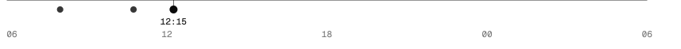

# Event track

Use an event track to edit discrete times on one axis. In the gallery each
marker is a cup of coffee. Moving a marker updates the chart and the readouts.
Available in **GUI**.



## Example

```pascal
unit Docs.Ui.Instruments.EventTrack;

uses Fpas.Ui.Elements as E, Fpas.Ui.Widgets.Charts.EventTracks as W,
  Fpas.Ui.Widgets.Charts.DotCharts as D;

// Builds the timeline for the cup editor.
// ## Parameters
// - `Cups`: Sorted times and selection from the model, such as `new W.Value([8.0, 10.75], 1)`.
// ## Returns
// The track with each proposed change as an application message.
public function View(Cups: W.Value): E.Element<W.Change>;
begin
  return W.EventTrack<W.Change>('cups', Cups, function(Change: W.Change): W.Change => Change,
    new W.Options(Capacity := 8, Minimum := 6.0, Maximum := 30.0, Step := 0.25,
      Units := D.AxisUnits.Hours, LabelStep := 6.0));
end function;

end unit;
```

## Options and defaults

| Option | Default or requirement |
| --- | --- |
| `Value.Times / Selected` | Supply sorted times. Selection defaults to minus one. |
| `Capacity / Minimum / Maximum` | 32 / 0 / 1. Use the same bounds as the chart when sharing an axis. |
| `Step / LabelStep / Units` | 0 / 0 / Number. Zero selects continuous input or automatic label spacing. |
| `Add / Remove / Axis / Enabled` | All true. |

## Interaction

Drag a marker to change its time. Double-click a marker to remove it when
removal is enabled. The focused track also supports keyboard movement.
Store `Change.Current` to accept a proposal, including selection changes.
`Added` and `Removed` identify the affected index or return minus one.
`Dragging` reports whether the drag is still in progress.

## See also

- [Widget API and types](../../../src/Fpas.Ui/Widgets/Charts/EventTracks.fpas)
- [Gallery update function](../../../examples/ui/gui/gallery/Pages/Instruments/Update.fpas)
- [Dot-matrix chart](dot-chart.md)
- [Instruments](README.md)
