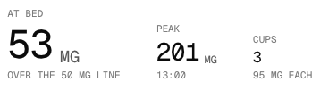

# Readout

Use a readout for a value with a label, optional unit and a line of context.
The gallery shows the estimated caffeine at bedtime, the daily peak and the cup count.
Available in **GUI**.



## Example

```pascal
unit Docs.Ui.Instruments.Readout;

uses Fpas.Ui.Elements as E, Fpas.Ui.Widgets.Display.Readouts as W;

// Displays the caffeine estimate for bedtime.
// ## Parameters
// - `Milligrams`: Value already formatted for display.
// - `AboveLimit`: Whether the estimate exceeds the threshold.
// ## Returns
// The readout for the application view.
public function View(Milligrams: string; AboveLimit: bool): E.Element<string>;
begin
  const Detail: string := if AboveLimit then 'OVER THE 50 MG LINE' else 'UNDER THE 50 MG LINE' end if;
  return W.Readout<string>('at-bed', 'AT BED', Milligrams,
    new W.Options(Unit := 'MG', Detail := Detail, Size := W.Size.Large, Accent := AboveLimit));
end function;

end unit;
```

## Options and defaults

| Option | Default or requirement |
| --- | --- |
| `Label / Value` | Pass strings. Format numbers and precision in your view. |
| `Unit / Detail` | Empty. The unit sits beside the value and the detail sits below it. |
| `Size` | Medium. Small, Medium and Large use 17, 28 and 44 logical points. |
| `Tone / Accent` | Neutral / false. Use Accent to draw the value with the theme accent. |
| `Align / Width` | Left / Content. |

## Interaction

The readout is passive. Pass updated text when the underlying value changes.

## See also

- [Widget API and types](../../../src/Fpas.Ui/Widgets/Display/Readouts.fpas)
- [Gallery example](../../../examples/ui/gui/gallery/Pages/Instruments/View.fpas)
- [Instruments](README.md)
