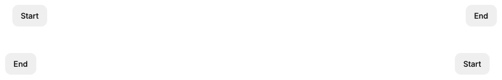

# Reading direction and spacing

Layout shows the same Start and End controls in left-to-right and
right-to-left rows.
Available in **GUI**.



## Example

```pascal
unit Docs.Ui.Layout.ReadingDirection;

uses Fpas.Ui.Elements as E, Fpas.Ui.Layout as L;

// Places the two labels on opposite sides of a mirrored row.
// ## Returns
// A row with explicit leading inset, gap and spacer.
public function View(): E.Element<string>;
begin
  return E.Row<string>(
    new L.Flow(
      ReadingDirection := L.Direction.RightToLeft,
      Padding := L.Spacing.Fixed(L.Measure.Logical(12)),
      PaddingStart := L.Spacing.Fixed(L.Measure.Logical(24))
    ),
    E.Text<string>('Start'),
    E.Gap<string>(L.Measure.Logical(12)),
    E.Spacer<string>(),
    E.Text<string>('End')
  );
end function;

end unit;
```

## Options and defaults

| Option | Default or requirement |
| --- | --- |
| `ReadingDirection` | Inherit. An explicit direction requires the GUI host. |
| `PaddingStart / PaddingEnd` | null / null. A value overrides the base padding for that logical edge. |
| `Gap / Spacer` | Gap is a fixed child on the main axis. Spacer uses available space. |

## Usage

Use start and end edges when the same row should mirror with the reading
direction. The element order and labels stay the same. Change
`Flow.Gap` to set the spacing between every pair of consecutive children.

## See also

- [Widget API and types](../../../src/Fpas.Ui/Layout.fpas)
- [Gallery example](../../../examples/ui/gui/gallery/Pages/Layout/View.fpas)
- [Gap and Spacer API](../../../src/Fpas.Ui/Elements.fpas)
- [Layered stack](stack.md)
- [Chapter index](README.md)
