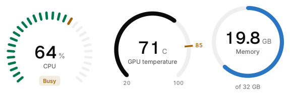

# Radial gauge

Use a radial gauge for a reading with an explicit scale, such as temperature or memory use. The gallery shows segments, an arc and a ring.

Available in **GUI**.



## Example

```pascal
unit Docs.Ui.MoreCharts.RadialGauge;

uses Fpas.Ui.Elements as E, Fpas.Ui.Widgets.Charts.RadialGauges as W;

// Builds the radial gauge example.
// ## Parameters
// - `Temperature`: Current temperature in degrees Celsius.
// ## Returns
// The widget for the application view.
public function View(Temperature: float): E.Element<string>;
begin
  return W.RadialGauge<string>('temp', Temperature, 20.0F, 100.0F,
    new W.Options(Label := 'GPU temperature', Unit := 'C', Target := 85.0F, Size := 180.0F));
end function;

end unit;
```

## Options and defaults

| Option | Default or requirement |
| --- | --- |
| `Value / Minimum / Maximum` | Supply a finite value and finite increasing limits. CUI clamps the fill to the scale and displays the actual reading. |
| `Style / Bands` | Automatic uses Segments when bands are supplied and Arc otherwise. Arc, Segments and Ring can be selected explicitly. Provide up to 16 increasing thresholds within the scale. |
| `Size / Sweep / ShowLimits / Target` | 0 / 0 / true / null. Zero uses native dimensions. A custom sweep is 90 through 300 degrees. An arc can draw the target marker. |
| `Label / Unit / Detail / Format / Color` | Empty / empty / empty / null / Automatic. Ring supports a detail caption. |

## Interaction

The gauge is passive. Pass the current reading from the model. CUI chooses a band color and status caption for segments. The arc can show scale limits and a target, and the ring can include a detail below the value.

## See also

- [Widget API and types](../../../src/Fpas.Ui/Widgets/Charts/RadialGauges.fpas)
- [Gallery example](../../../examples/ui/gui/gallery/Pages/MoreCharts/Widgets/Market.fpas)
- [Gauge](../charts/gauge.md)
- [More charts](README.md)
