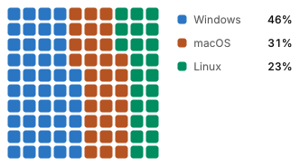

# Waffle

Use a waffle chart to show shares as colored squares. The gallery shows the platform counts for 100 installs.

Available in **GUI**.



## Example

```pascal
unit Docs.Ui.MoreCharts.Waffle;

uses Fpas.Ui.Elements as E, Fpas.Ui.Widgets.Charts.Waffles as W,
  Fpas.Ui.Widgets.Charts.Charts as C;

// Builds the waffle example.
// ## Returns
// The widget for the application view.
public function View(): E.Element<string>;
begin
  return W.Waffle<string>('waffle', [
    new C.Item('Windows', 46.0F), new C.Item('macOS', 31.0F), new C.Item('Linux', 23.0F)
  ], new W.Options(CellSize := 14.0F));
end function;

end unit;
```

## Options and defaults

| Option | Default or requirement |
| --- | --- |
| `Items` | Named nonnegative amounts with a finite sum. |
| `Columns / Rows` | 10 / 10. Each takes a value from 1 through 60. |
| `CellSize / Format / Enabled` | 0 / null / true. Zero selects the native square size. |

## Interaction

CUI allocates squares to each item in proportion to its share. Hover to inspect it. An optional `OnActivate` callback receives the index of the item associated with the clicked square.

## See also

- [Widget API and types](../../../src/Fpas.Ui/Widgets/Charts/Waffles.fpas)
- [Gallery example](../../../examples/ui/gui/gallery/Pages/MoreCharts/View.fpas)
- [Split bar](split-bar.md)
- [More charts](README.md)
