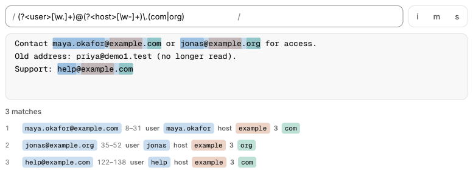

# Regex tester

Use a regex tester to preview how a CUI pattern matches sample text.
The gallery marks email matches and their named groups.
Available in **GUI**.



## Example

```pascal
unit Docs.Ui.MoreDeveloperTools.RegexTester;

uses Fpas.Ui.Elements as E, Fpas.Ui.Widgets.Developer.RegexTesters as W;

// Edits a pattern and its test text.
// ## Parameters
// - `Pattern`: Current regular expression.
// - `Sample`: Current sample text.
// - `Modifiers`: Native flag mask.
// ## Returns
// The tester with edits, validity and match count as messages.
public function View(Pattern: string; Sample: string; Modifiers: int): E.Element<W.Event>;
begin
  return W.RegexTester<W.Event>('regex', Pattern, Sample, Modifiers,
    function(Change: W.Event): W.Event => Change, new W.Options(Height := 110.0F));
end function;

end unit;
```

## Options and defaults

| Option | Default or requirement |
| --- | --- |
| `Modifiers` | Bits 1, 2 and 4 select case-insensitive, multiline and dot-all matching. |
| `PatternCapacity / TextCapacity` | 127 / 1023. They limit the UTF-8 edit buffers. |
| `Width / Height / Enabled` | Fill / 0 / true. |

## Interaction

Edit the pattern, flags or sample to receive `Event.Valid` and `Matches`
along with the updated inputs. The tester uses CUI's regex syntax. Keep
the proposal in the model if you want edits to persist.

## See also

- [Widget API and types](../../../src/Fpas.Ui/Widgets/Developer/RegexTesters.fpas)
- [Gallery example](../../../examples/ui/gui/gallery/Pages/MoreDeveloper/View.fpas)
- [More developer tools](README.md)
