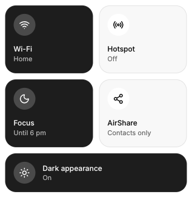

# Control tile

The gallery shows Wi-Fi, Hotspot, Focus and AirShare, plus a wide
Dark appearance tile.
Available in **GUI**.



## Example

```pascal
unit Docs.Ui.Motion.ControlTile;

uses Fpas.Ui.Elements as E, Fpas.Ui.Widgets.Audio.ControlTiles as W, System as Sys;

// Toggles the Wi-Fi setting.
// ## Parameters
// - `On`: Whether Wi-Fi is enabled in the model.
// ## Returns
// The tile with the proposed state as its message.
public function View(On: bool): E.Element<bool>;
begin
  return W.ControlTile<bool>('wi-fi', 'Wi-Fi', On, function(Next: bool): bool => Next,
    new W.Options(Icon := Sys.Char.ConvertFromUtf32($E1AE)));
end function;

end unit;
```

## Options and defaults

| Option | Default or requirement |
| --- | --- |
| `Icon / Detail / Color` | Empty / empty / Automatic. Set Detail to describe the current state. |
| `Width / Wide / Enabled` | Fill / false / true. Wide selects the horizontal layout. |

## Interaction

Activate the tile to propose the opposite state. Store the new value
and update any detail text in the model.

## See also

- [Widget API and types](../../../src/Fpas.Ui/Widgets/Audio/ControlTiles.fpas)
- [Gallery example](../../../examples/ui/gui/gallery/Pages/Motion/Controls.fpas)
- [Motion](README.md)
