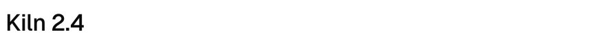

# Gradient text

The gallery draws the Kiln heading with an animated gradient.
Available in **GUI**.



## Example

```pascal
unit Docs.Ui.Motion.GradientText;

uses Fpas.Ui.Elements as E, Fpas.Ui.Widgets.Motion.GradientTexts as W, Fpas.Ui.Widgets.Motion.Motion as M;

// Draws a release heading.
// ## Parameters
// - `Title`: Heading text.
// ## Returns
// The native gradient text.
public function View(Title: string): E.Element<string>;
begin
  return W.GradientText<string>('release-title', Title,
    new W.Options(Font := M.Font.Display, Size := 34.0F, Animate := true));
end function;

end unit;
```

## Options and defaults

| Option | Default or requirement |
| --- | --- |
| `Font / Size / Width` | Body / 0 / Content. |
| `From / To` | Both Automatic. Supply colors to override the native gradient endpoints. |
| `Animate` | false. Lets the gradient drift along the text. |

## Interaction

Use the widget wherever styled text fits. CUI handles the gradient and
the animation. Reduced motion keeps the gradient still.

## See also

- [Widget API and types](../../../src/Fpas.Ui/Widgets/Motion/GradientTexts.fpas)
- [Gallery example](../../../examples/ui/gui/gallery/Pages/Motion/View.fpas)
- [Motion](README.md)
