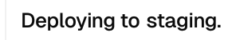

# Rotating words

The gallery rotates a deployment destination in a sentence.
Available in **GUI**.



## Example

```pascal
unit Docs.Ui.Motion.RotatingWords;

uses Fpas.Ui.Elements as E, Fpas.Ui.Widgets.Motion.WordRotations as W, Fpas.Ui.Widgets.Motion.Motion as M;

// Shows one of the current deployment target labels.
// ## Parameters
// - `Targets`: Short phrases to cycle through.
// ## Returns
// The rotating word effect.
public function View(Targets: array of string): E.Element<string>;
begin
  return W.WordRotate<string>('destination', Targets, 2.2F,
    new M.TextOptions(Font := M.Font.Display, Size := 26.0F));
end function;

end unit;
```

## Options and defaults

| Option | Default or requirement |
| --- | --- |
| `Words / Interval` | Supply the phrases in display order. Zero Interval uses native timing. A positive interval is in seconds. |
| `Font / Size / Color` | Body / 0 / Automatic. |

## Interaction

Place the effect next to a fixed label. CUI rolls each new phrase into
place and adjusts the width to it. The application supplies the phrases.

## See also

- [Widget API and types](../../../src/Fpas.Ui/Widgets/Motion/WordRotations.fpas)
- [Gallery example](../../../examples/ui/gui/gallery/Pages/Motion/View.fpas)
- [Motion](README.md)
