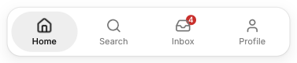

# Tab bar

The gallery presents Home, Search, Inbox and Profile with a badge on Inbox.
Available in **GUI**.



## Example

```pascal
unit Docs.Ui.Motion.TabBar;

uses Fpas.Ui.Elements as E, Fpas.Ui.Widgets.Navigation.TabBars as W;

// Shows navigation tabs for a compact view.
// ## Parameters
// - `Tabs`: Icons, captions and badge counts in display order.
// - `Selected`: Selected zero-based index.
// ## Returns
// The bar with a proposed tab index.
public function View(Tabs: array of W.Item; Selected: int): E.Element<int>;
begin
  return W.TabBar<int>('bottom-tabs', Tabs, Selected, function(Index: int): int => Index);
end function;

end unit;
```

## Options and defaults

| Option | Default or requirement |
| --- | --- |
| `Item.Icon / Label / Badge` | Supply the glyph and label. Badge defaults to zero, which hides it. |
| `Width / LabelsOnSelection / Enabled` | Fill / false / true. LabelsOnSelection shows just the selected label. |

## Interaction

Apply a proposed index to the model and display its associated view.
The bar animates the selection indicator.

## See also

- [Widget API and types](../../../src/Fpas.Ui/Widgets/Navigation/TabBars.fpas)
- [Gallery example](../../../examples/ui/gui/gallery/Pages/Motion/Controls.fpas)
- [Tabs](../navigation/tabs.md)
- [Motion](README.md)
