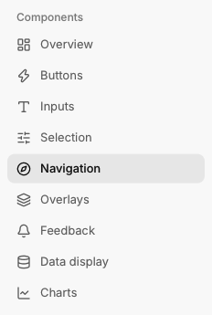

# Sidebar navigation

Use a sidebar for named destinations grouped under optional headings. Available in **GUI and TUI**.



## Example

```pascal
unit Docs.Ui.Navigation.Sidebar;

uses Fpas.Ui.Elements as E, Fpas.Ui.Widgets.Navigation.Navigation as C;

// Builds the sidebar navigation example.
// ## Parameters
// - `Active`: Current value from the application model.
// ## Returns
// The widget for the application view.
public function View(Active: string?): E.Element<string>;
begin
  return C.Sidebar<string>('navigation', [
    new C.Section<string>('Workspace', [
      new C.Item<string>('overview', 'Overview', 'overview'),
      new C.Item<string>('inbox', 'Inbox', 'inbox', Badge := '3')
    ])
  ], Active);
end function;

end unit;
```

## Options and defaults

| Option | Default or requirement |
| --- | --- |
| `ActiveKey` | A destination key or null for no active destination. |
| `Title / GapBefore` | Use an empty title to omit the heading. GapBefore defaults to 0. Positive spacing requires GUI. |
| `Icon / Badge` | Both empty by default. GUI supports CUI icons. Both hosts show badges. |
| `Enabled` | true for the sidebar and for each item. |

## Interaction

Click a destination or activate it with Enter or Space while it has focus. The sidebar sends the item's message. Update the active key and displayed page together. Keys are unique across the sidebar. Use `ItemId(Id, Key)` for focus. Place the sidebar in a scroll view when its sections exceed the available height.

## See also

- [Widget API and types](../../../src/Fpas.Ui/Widgets/Navigation/Navigation.fpas)
- [Gallery example](../../../examples/ui/gui/gallery/App/Sidebar.fpas)
- [Tabs](tabs.md)
- [Navigation](README.md)
